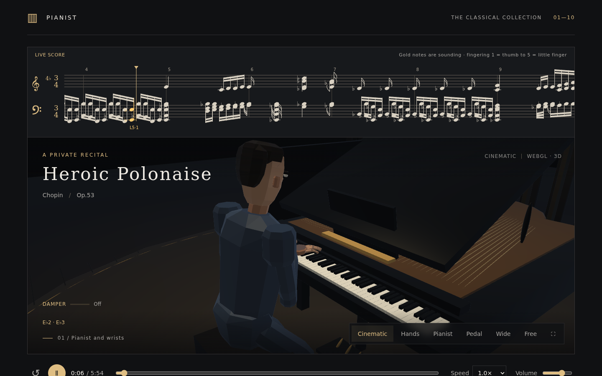

# pianist

Live demo: https://reki2000.github.io/demos-pianist/



A WebGL 3D recital featuring 12 solo instruments and 2 chamber ensembles with synchronized audio, live scrolling score, and multi-angle concert cameras.

## What You Can Play

### Solo Instruments

| Instrument | Pieces | Repertoire |
|---|---|---|
| **Piano** | 18 | Chopin (*Heroic Polonaise*, *Raindrop Prelude*, *Revolutionary Étude*, *Fantaisie-Impromptu*, *Prelude in E minor*), Beethoven (*Für Elise*, *Moonlight Sonata I*), Debussy (*Clair de Lune*, *Golliwogg's Cakewalk*), Mozart (*Rondo alla Turca*), Bach (*WTC Prelude No. 1*), Satie (*Gymnopédie No. 1*), Schumann (*Träumerei*), Liszt (*Liebestraum No. 3*), Joplin (*The Entertainer*, *Maple Leaf Rag*), Traditional (*When the Saints Go Marching In*, *Amazing Grace*) |
| **Guitar** | 6 | Albéniz (*Asturias*, *Granada*, *Sevilla*), Tárrega (*Recuerdos de la Alhambra*, *Capricho Árabe*), Granados (*Andaluza*) |
| **Violin** | 4 | Bach (*Air on the G String*, *Preludio from Partita No. 3*), Monti (*Csárdás*), Massenet (*Méditation from Thaïs*) |
| **Viola** | 2 | Telemann (*Viola Concerto in G*), Bach (*Suite No. 1 — Prelude*) |
| **Cello** | 4 | Bach (*Suite No. 1 — Prelude, Gigue, Menuets I & II*), Saint-Saëns (*The Swan*) |
| **Flute** | 3 | Bach (*Badinerie*), Gluck (*Dance of the Blessed Spirits*), Debussy (*Syrinx*) |
| **Oboe** | 3 | Marcello (*Oboe Concerto — Adagio*), Bach (*Sinfonia / Arioso*), Mozart (*Oboe Quartet in F*) |
| **Clarinet** | 2 | Mozart (*Clarinet Concerto — Adagio*, *Clarinet Quintet — Allegro*) |
| **Trumpet** | 2 | Clarke (*Prince of Denmark's March*), Haydn (*Trumpet Concerto — Finale*) |
| **Harp** | 2 | Bach (*Prelude in C Major*), Debussy (*Arabesque No. 1*) |
| **Double Bass** | 2 | Saint-Saëns (*The Elephant*), Beethoven (*Symphony No. 9 — Bass Theme*) |
| **Percussion** | 2 | Bach (*Invention No. 4* — Marimba), Beethoven (*Symphonic Timpani Fanfare* — 4 Copper Timpani) |

### Ensembles

| Ensemble | Performers | Repertoire |
|---|---|---|
| **String Quartet** | 4 players (Violin I, Violin II, Viola, Cello) | Mozart (*Eine kleine Nachtmusik*), Pachelbel (*Canon in D*) |
| **All-Star Decet** | 10 players (Flute, Oboe, Guitar, Piano, 4 Violins, 2 Cellos) | Pachelbel (*Canon in D — Grand Decet*), Bach (*Brandenburg Concertino in G*) |

## Controls

- **Instrument bar (top)**: Switch between any of the 12 solo instruments and 2 ensembles (selection is saved in the URL).
- **Transport**: Play/pause (`Space`), restart, seek bar, playback speed, and volume.
- **Live Score**: Scrolls in sync with playback; collapses into an accordion bar for ensembles.
- **Camera**: Cinematic (12 concert shots per mode), Hands, Portrait, Detail/Pedal, Wide, Free (drag to rotate, scroll/pinch to zoom), and Fullscreen.

## Run Locally

```bash
python3 -m http.server 8000 --directory dist
```

Open `http://localhost:8000` in your browser. See [THIRD-PARTY-NOTICES.md](THIRD-PARTY-NOTICES.md) for MIDI and audio sample attributions.
