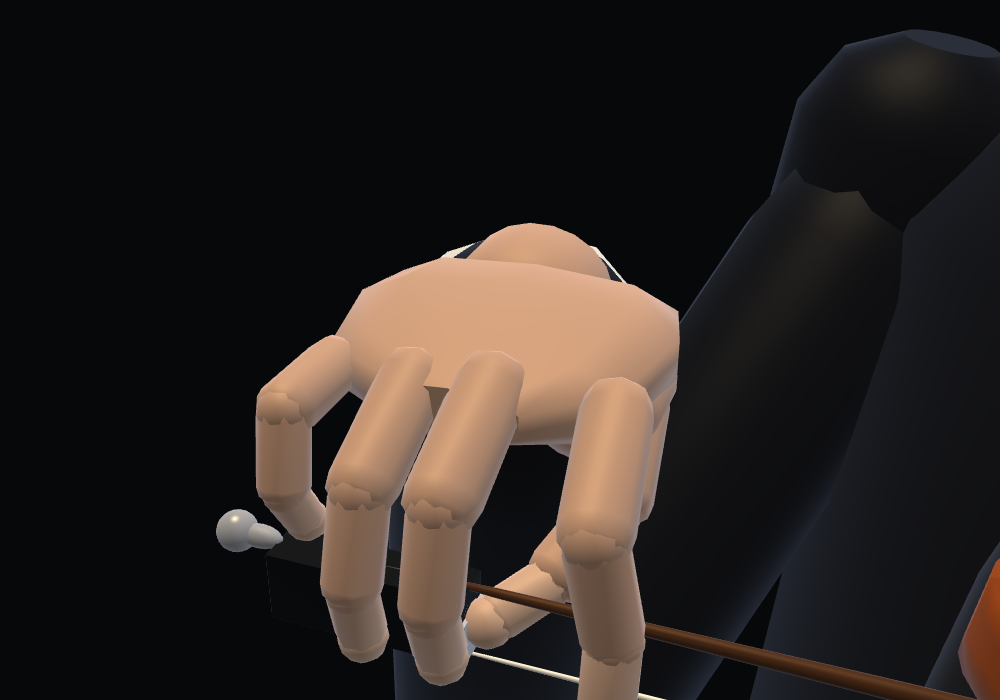
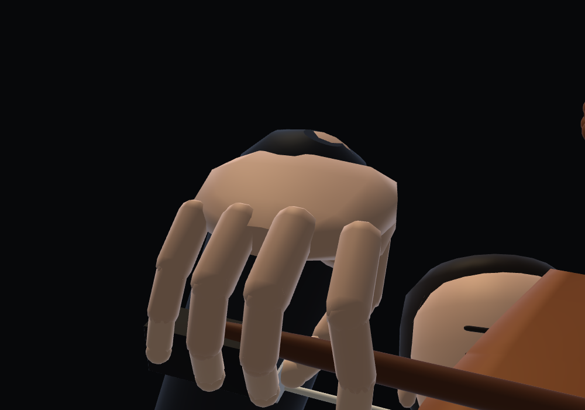
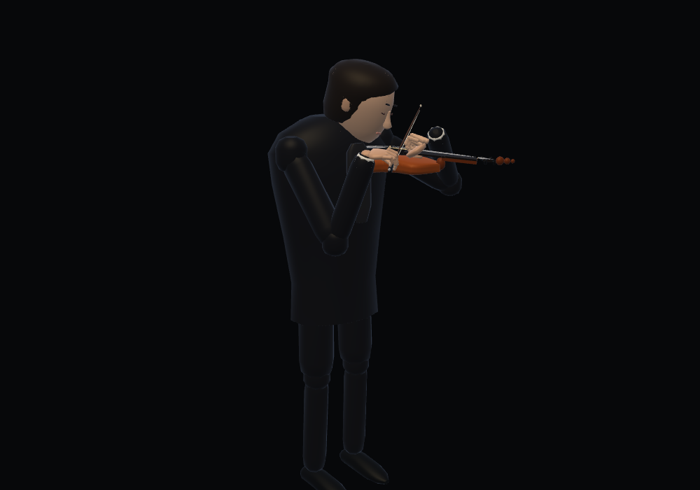
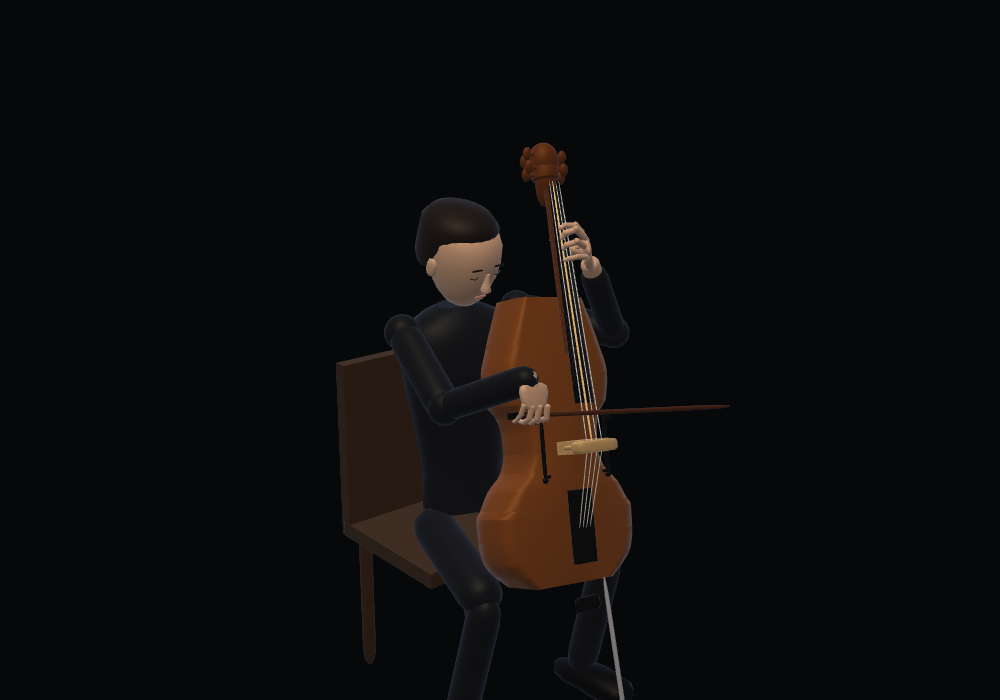

# Five-finger bow holds

Both right hands now have a bent thumb and four articulated fingers. The index
bears on its middle phalanx; middle and ring fingers drape over the frog. The
violin pinky curves onto the top of the stick; the cello pinky drapes down the
frog side. The thumb supports the underside near the stick/frog junction,
opposite the middle finger. These are simplified relaxed overhand reference
poses, with distinct contact positions for the two instruments.

References consulted (2026-11-12):

- [Manukau Youth Orchestra — Violin Bow Hold](https://www.manukauyouthorchestra.org.nz/violin/bowhold/): bent opposing thumb, hooked pinky on top; illustrated from several angles.
- [Cello Online — Cello Bow Hold](https://www.celloonline.com/bowplacement.htm): bent thumb and fingers over the stick; cello pinky drapes instead of balancing on top as on a violin.
- [School of Cello Playing — Article II: Bow Hold](https://uidaho.pressbooks.pub/violoncellschule/chapter/s1-a02-md/): thumb/stick/frog junction, middle finger near the ferrule, ring and little fingers on the frog; available search excerpt (direct page returned 403).

`dist/instruments/bow-hand.js` solves the reference finger chains once, then
transforms them rigidly with the bow. The planning frame reflects X on display;
the wrist basis accounts for that reflection so the hand is anatomically right.
Right-arm IK follows the hand's carpus. Cello cached poses derive the new hand
after interpolation, retaining the shipped left-hand cache. Cello bow rendering
uses the same continuous string-crossing geometry as the hand instead of a
rounded string index. Violin cached poses rebuild the grip after interpolation.
Face meshes and face drawing passes are unchanged.

`node bow-hold-test.cjs` covers all seven pieces at 707 poses: five digits,
15 phalange segments, constant bone lengths, contact with the actual frog/stick
surface, instrument-specific pinky placement and connected, unstretched arms.
Maximum contact discrepancy is 0.5 mm at the ferrule's additional metal width;
bone-length changes are at floating-point rounding level. `checks.json` records
the results. Geometry/face regression and local integration checks also pass;
upstream byte comparisons require the separate source checkouts.

Chromium/SwiftShader snapshots use each instrument's default piece at 12 s,
including the production cello pose cache. Expanded views show the five digits;
wide views show the wrist/arm connection. WebGL and page-error checks were clean.

| | Violin | Cello |
|---|---|---|
| Grip |  |  |
| Performer |  |  |

The five right-hand digits now use continuous skin over the same grip skeleton. Updated images and resource checks: [bow skin verification](../bow-skin/README.md).
