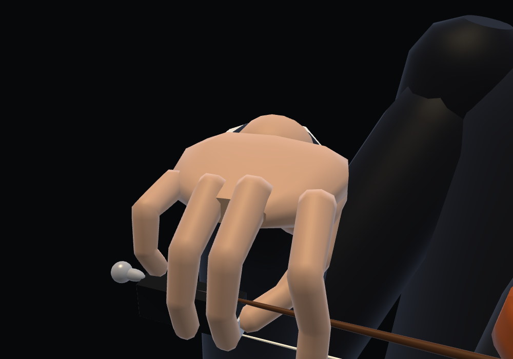
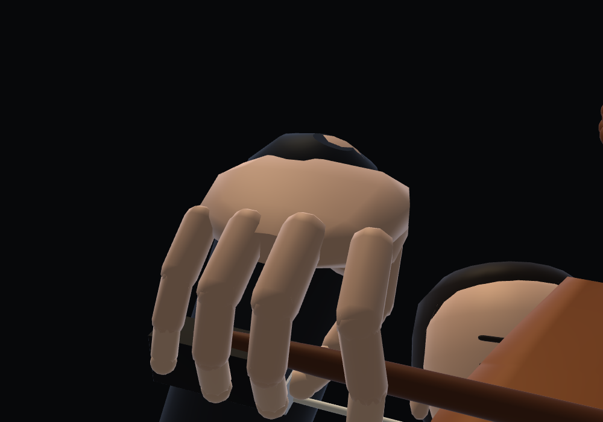
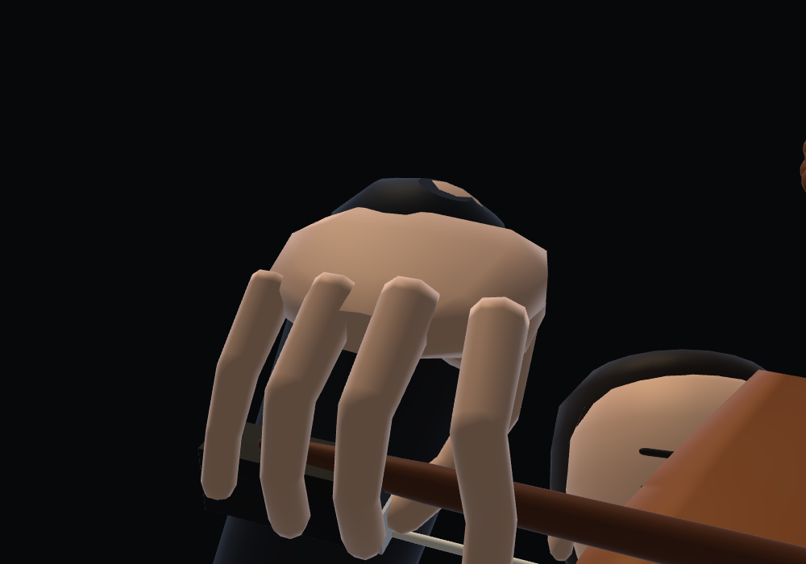
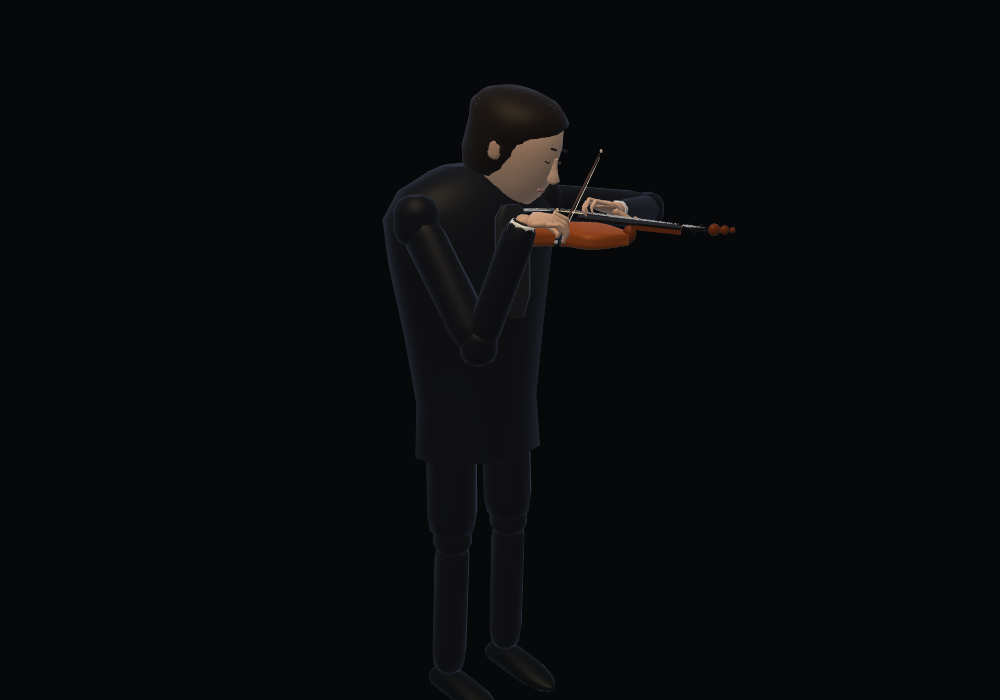
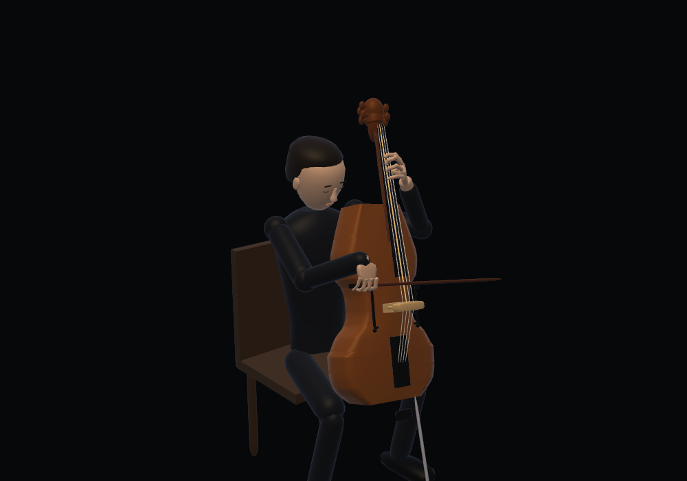

# Continuous bow-hand skin

Violin and cello right hands now use the same continuous ring-surface method as
the violin left fingers. All five digits, including the thumb, are closed
surfaces with shared vertices and area-weighted normals across their joints.
Each digit has twelve eight-sided rings. The base overlaps the palm, joint
frames blend along the existing phalanges, and rounded end pads retain the
original grip radii. Each instrument keeps its researched grip, bone lengths,
contact targets, wrist and arm motion. The violin left hand's selected B length
and skin remain unchanged, as does the face draw-data baseline.

The five digits share one mesh: 960 triangles and one draw call in place of
30 separate segment/joint/tip draws (4,320 triangles). The palm, wrist and thenar remain separate.
Unlike the changing left fingers, each bow grip moves rigidly. Its local skin
is built once per instrument, uploaded once per renderer, then drawn with the
bow's frame. There is no per-frame skin construction or vertex upload. Cached
CPU arrays are bounded to the two instrument grips; GPU storage belongs to the
renderer and is reused across song/instrument switches.

| Violin, before | After |
|---|---|
|  |  |

| Cello, before | After |
|---|---|
|  |  |

Verification:

- `node bow-skin-test.cjs`: five connected closed surfaces, edge incidence and
  winding, finite vertices and unit normals; one immutable mesh per instrument
  across 707 poses from all seven pieces. Surface triangles stay within 1 mm of
  each researched contact target (maximum sampled gap 0.815 mm). 4,500 frames across both instruments allocate/upload two GPU buffers in
  total and perform zero buffer updates. The supplied hand skeleton is unchanged.
- `node bow-hold-test.cjs`: the original contact, fixed-bone, digit-order, wrist,
  arm reach and instrument-specific little-finger checks still pass.
- `node violin-skin-test.cjs` and `node violin-left-hand-test.cjs`: the shortened
  left fingers, skin topology, contacts and sampled clearance still pass.
- Chromium/SwiftShader close-ups and full scenes show both skins, with WebGL
  errors 0 and wrist gap 0. The existing 75-second shell playback test checks
  stable GPU buffer count and continued playback beyond a minute, then switches
  through three violin pieces and all four instruments without page/GL errors.
- Geometry face fingerprints and local shell integration checks pass. Upstream
  source-repository byte checks require separate checkouts unavailable here.

The surfaces remain deliberately low-poly. Contact checks sample each static
local grip surface, which is then transformed rigidly with its exact contact
frame; they do not prove the absence of every finger-to-finger collision.
Playback tests verify progression/resource reuse, not listening on the reported
user device. Machine-readable results accompany this file; full scene counts
are in [geometry-budget](../geometry-budget/README.md).
