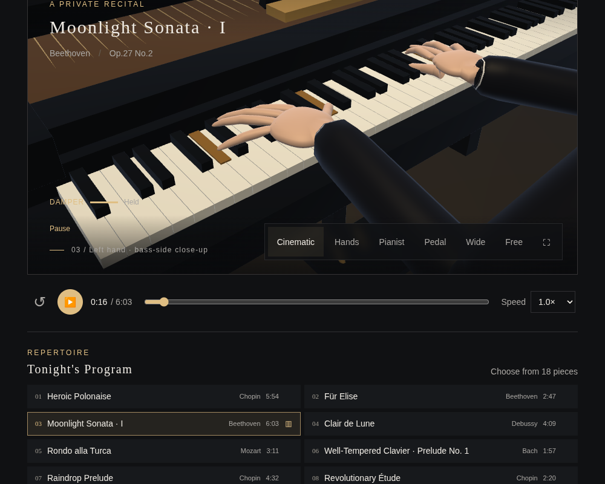
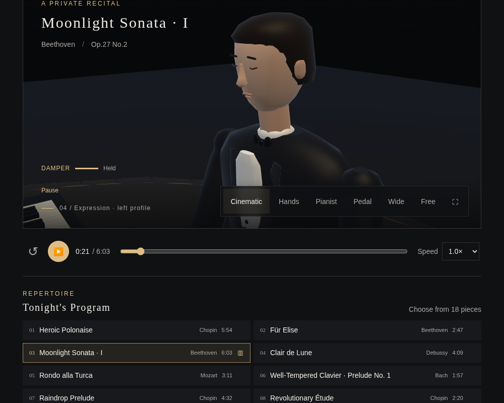
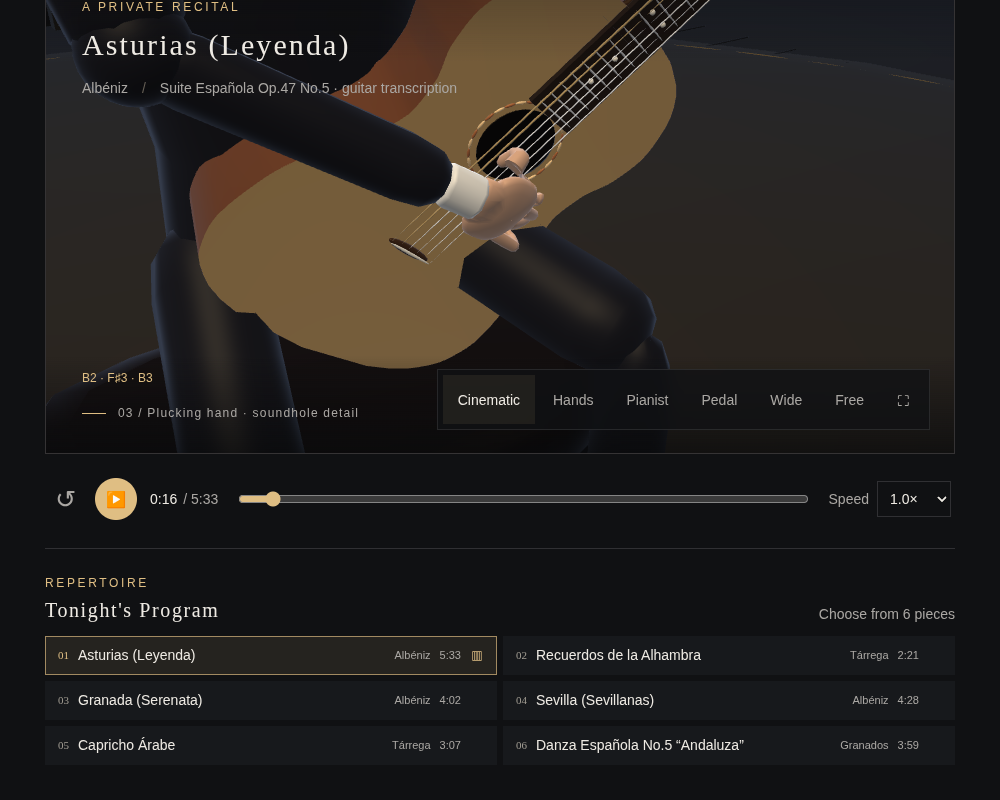
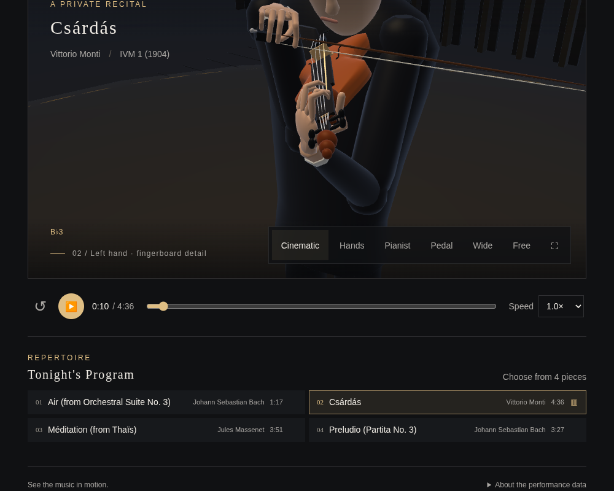
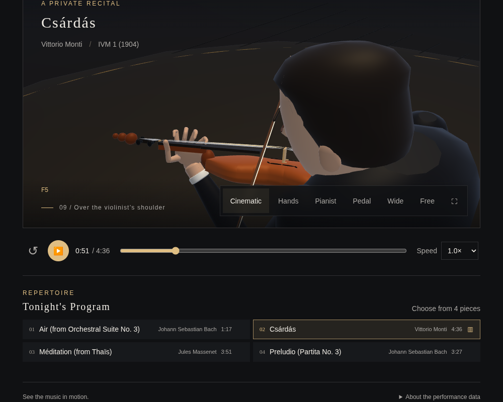
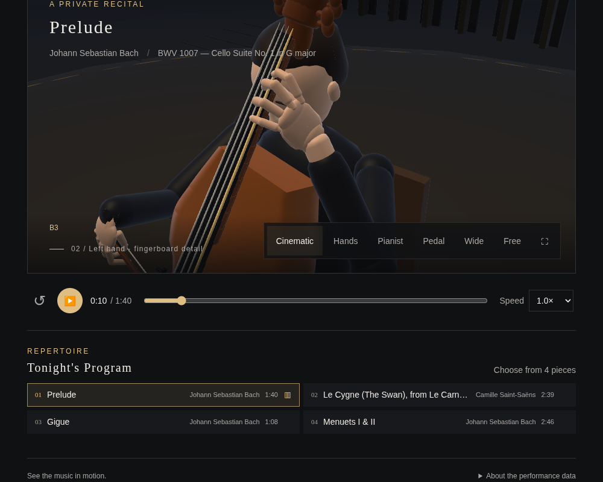

# Cinematic concert coverage

Each instrument has **12 shots**, lasting **5–7 seconds**, in a 72–73 second
sequence. Coverage alternates the left hand, right hand, both hands, the face
and profile, shoulders, high/low angles and wide reverse angles. A slow arc
and a small push-in or pull-out animate each shot. Cuts are deliberate; the
camera does not interpolate through the instrument to reach the next angle.

Hand close-ups use the actual palm positions. A bounded three-target filter
softens fast musical shifts. Both-hand framing accounts for hand separation,
viewport aspect and the renderer's field of view. Piano overhead shots retain
their Z-up orientation. Portrait-mode viewing uses distance from the shot's
target, without the former extra global camera offset.

Motion uses the playback clock: pause holds the framing; seeking and changing
pieces reset subject tracking. Reduced-motion preferences keep each shot
static while retaining the cuts. Camera presets and the Free Camera gestures
remain available, including taking over from the current cinematic view.
No nonlinear hand fitter, growing history or additional event listeners are
introduced by the cinematic controller.

Verification:

- [Native camera checks](camera.json): all 48 shots, 576 projected views over
  four viewport aspects, subject containment, non-degenerate up vectors, arcs
  and dollies, pause, seek, new-song reset and reduced motion.
- [Chromium rendering](browser.json): every shot on all four instruments at
  1000 × 800 and 390 × 844, camera movement within shots, reduced-motion
  behavior, subject centering and JavaScript/WebGL errors. Runtime guitar and
  violin fit counts remain zero. This is browser emulation, not a physical
  iOS/Android test.
- [Piano playback/clock checks](piano.json), [local shell integration](../repertoire/integration.json),
  and [touch camera regression](../mobile-camera/browser.json).

Representative views:








```sh
node cinematic-camera-test.cjs
node camera-gestures-test.cjs
NODE_PATH=/path/to/playwright/node_modules node cinematic-camera-browser-test.cjs
NODE_PATH=/path/to/playwright/node_modules node camera-gestures-browser-test.cjs
```
