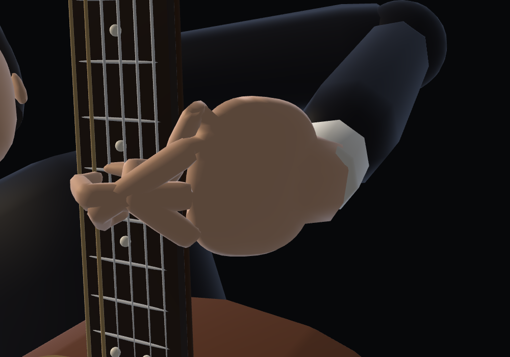
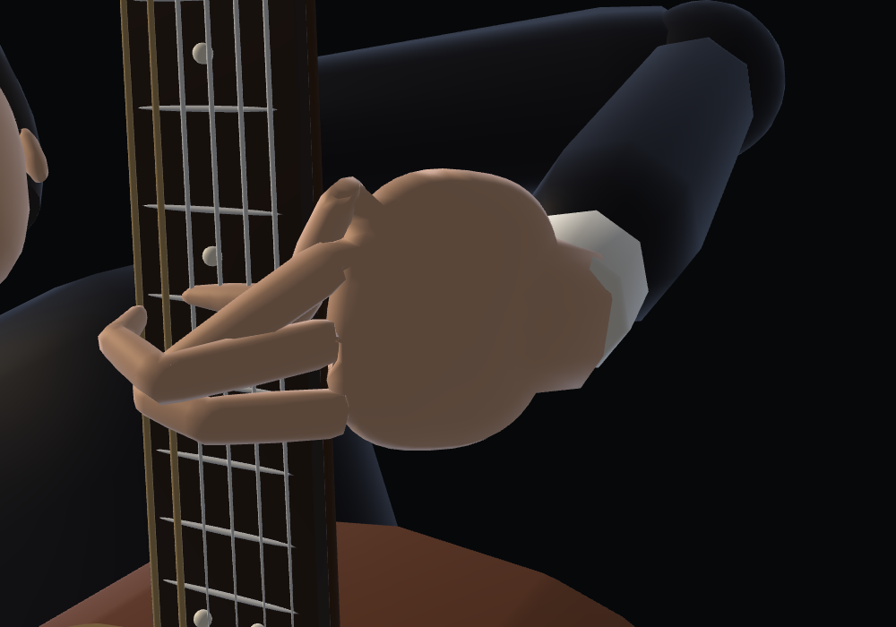
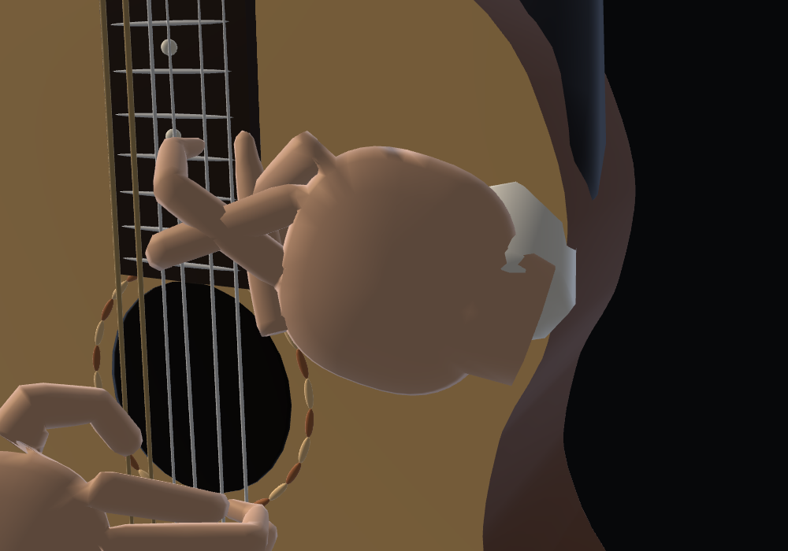
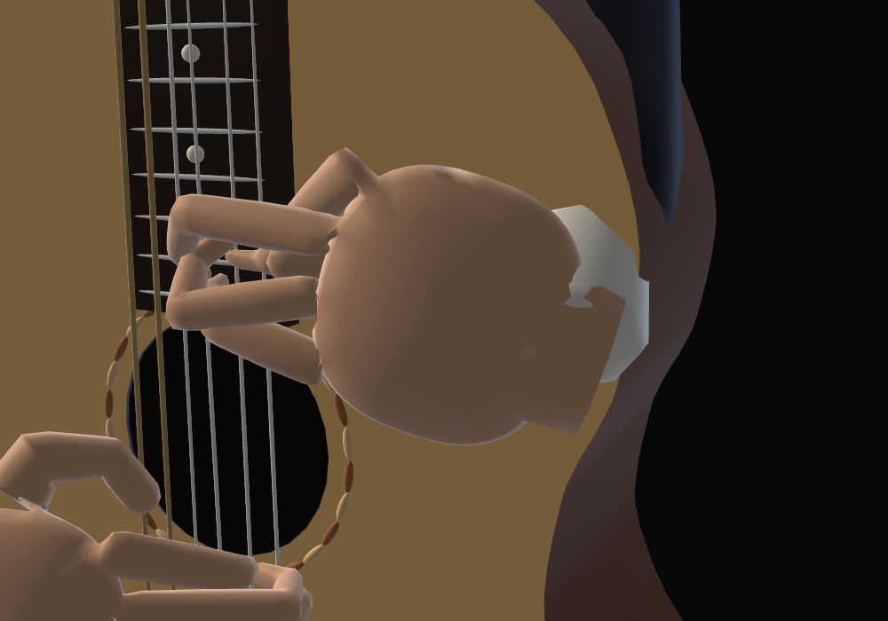
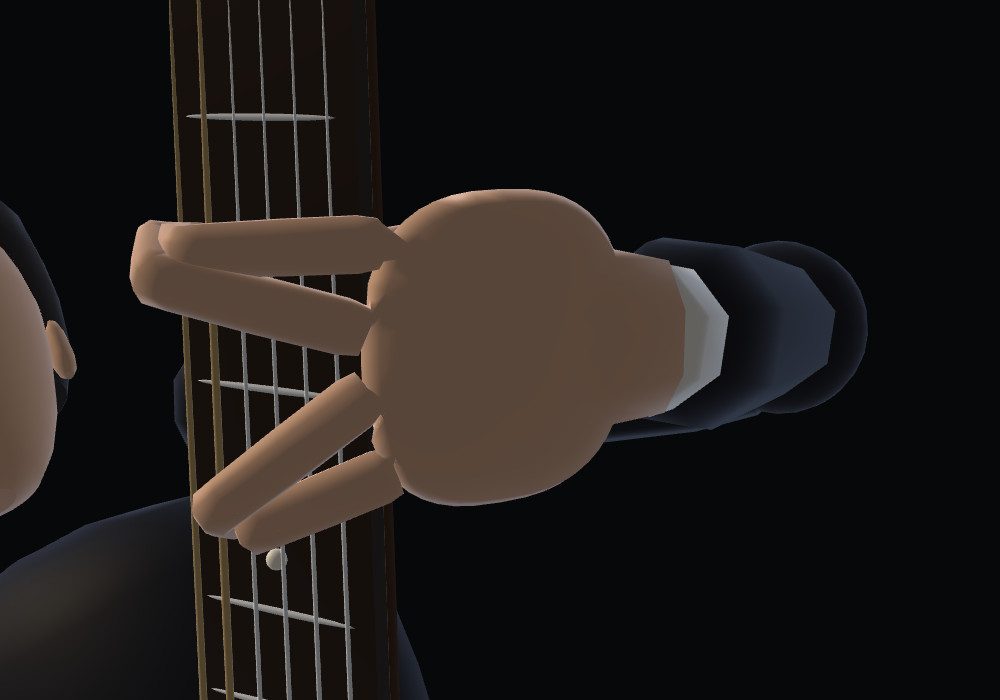
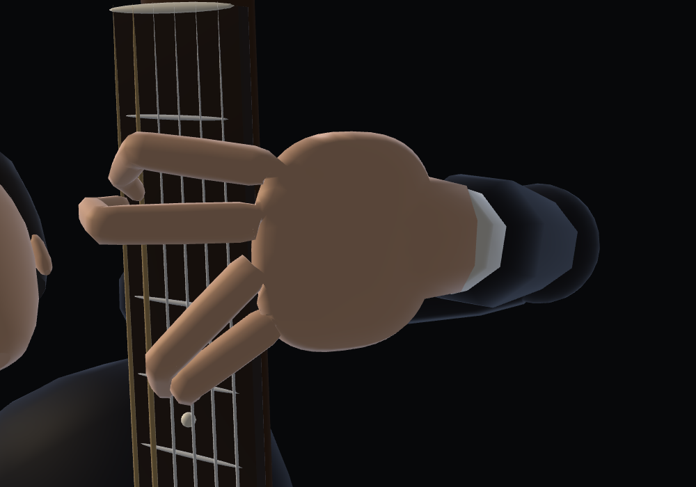

# Guitar finger crossings and barre handoffs

The previous hand fit checked contact with the instrument but did not check one finger against another. At sampled note onsets, 1,275 finger pairs approached within 2 mm of their bone centrelines. Resting fingers could chase a distant future note, and a finger could remain at a string while another finger took over the same place.

This change adds four offline finger flexion-plane coordinates to the wrist trajectory. They change how each finger arches while keeping its knuckle root, all three bone lengths and its sounding fingertip fixed. Playback interpolates these coordinates and uses analytic IK; no collision search runs in the browser.

Free fingers return toward a hand-local relaxed curl. Preparation starts at most 120 ms before the next attack, with a continuous transition from the released pose. A former fretting finger lifts before a different finger takes over its string or an index barre takes over its fret. Obsolete holds ending at the next chord release before its onset. Audio note data is unchanged.

The fingering pass prefers an existing index barre for an equal-fret note on string 1. It preserves higher-fret melody notes and avoids extending a barre through a sounding open/lower-fret string. A little finger pressing a higher fret than the index barre is sometimes necessary; this rule does not replace that note with the lower pitch of the barre.

Regression fixtures cover equal-fret barre reuse, higher notes, open strings, and fixed-bone/contact preservation when the flexion plane changes. An independent finite-segment test checks finger bone separation at 60 Hz, at note attacks and at motion boundaries. This checks actual 3D crossings rather than projected overlaps: a finger can pass above another without crossing through it.

The final independent audit covers 131,318 poses, including 60 Hz samples across all six pieces. Minimum bone separation is 4.507 mm (required: 4.5 mm); the former 1,275 pairs within 2 mm at note onsets are eliminated. The source score still contains the same 9,709 notes, with unchanged pitches, times, durations and velocities. The contact audit measures a maximum fretting error of 0.498 mm.

Reports: [fingering fixtures](fingering.json), [finger separation](clearance.json). Existing [skeleton/contact](../guitar-hands/verification.json), [skin/instrument clearance](../guitar-hands/skin.json), [continuity](../guitar-hands/continuity.json) and [browser playback](../guitar-hands/browser.json) audits also apply. Faces, instrument dimensions and source notes remain unchanged.

| Pose | Before | After |
| --- | --- | --- |
| Granada, 12 s |  |  |
| Asturias, 93.91302 s |  |  |
| Asturias, 158.83869 s |  |  |

```sh
node guitar-fingering-hand-test.cjs
node precompute-guitar-plans.cjs
GUITAR_HAND_WORK=/tmp/guitar-hand-build node precompute-guitar-hands.cjs
node refine-guitar-clearance.cjs
node guitar-finger-clearance-test.cjs
node guitar-hand-test.cjs
node guitar-skin-test.cjs
node guitar-continuity-test.cjs
```
