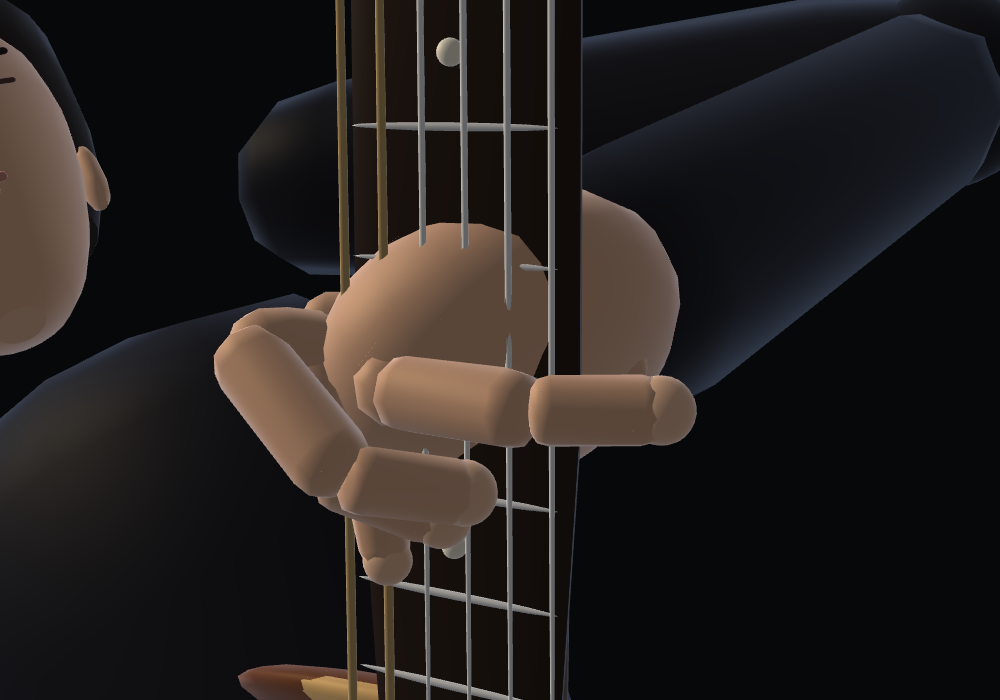
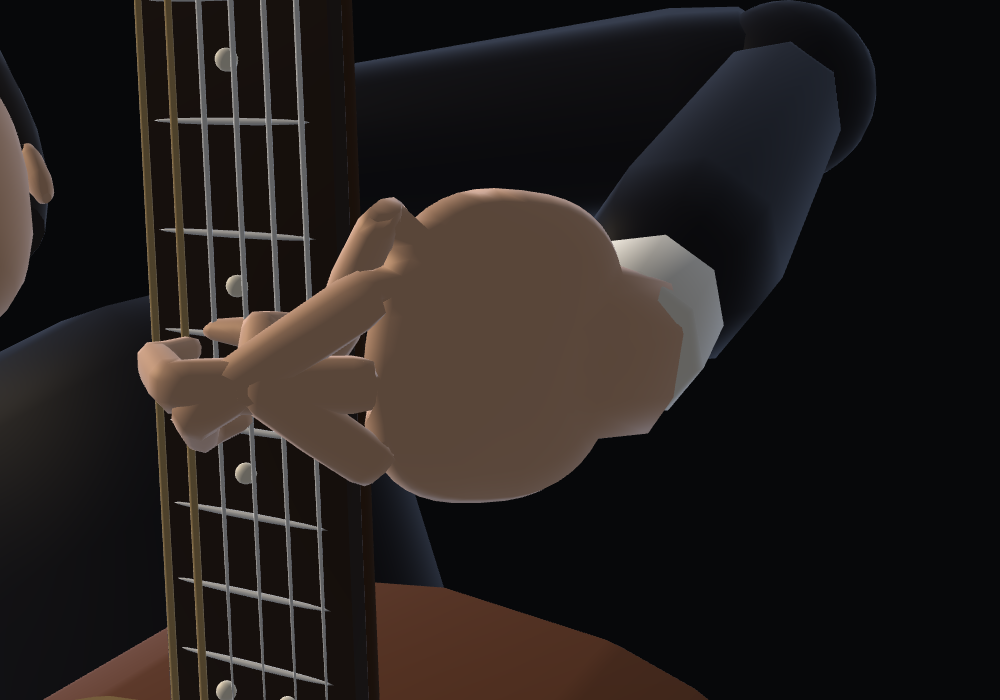
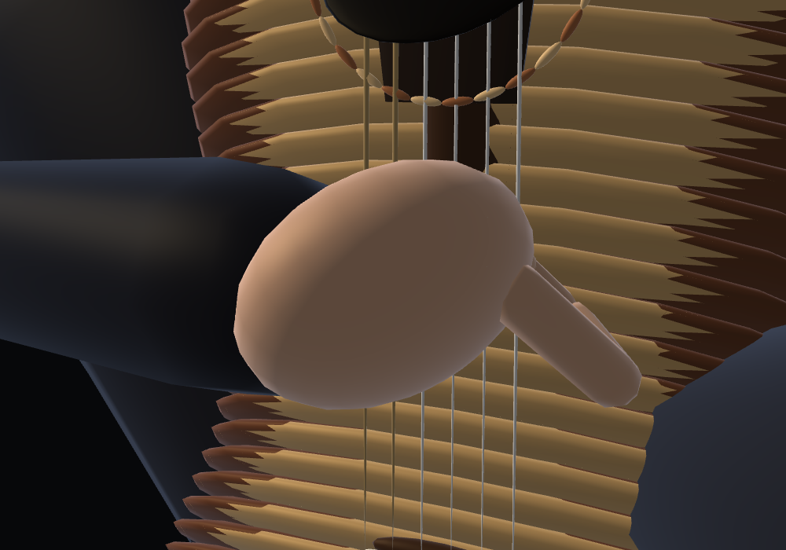
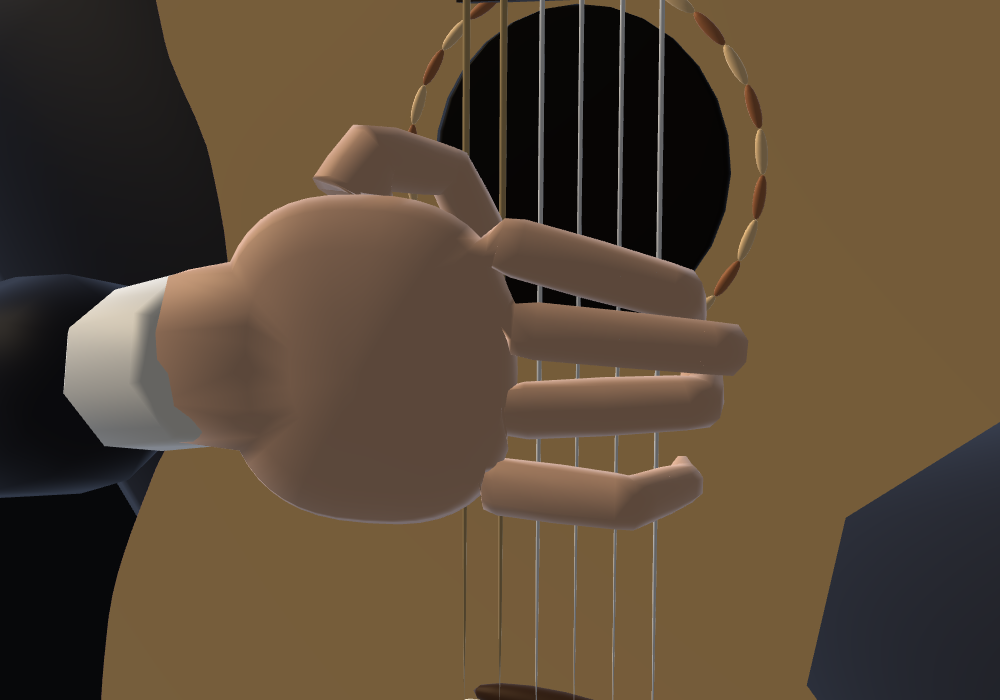
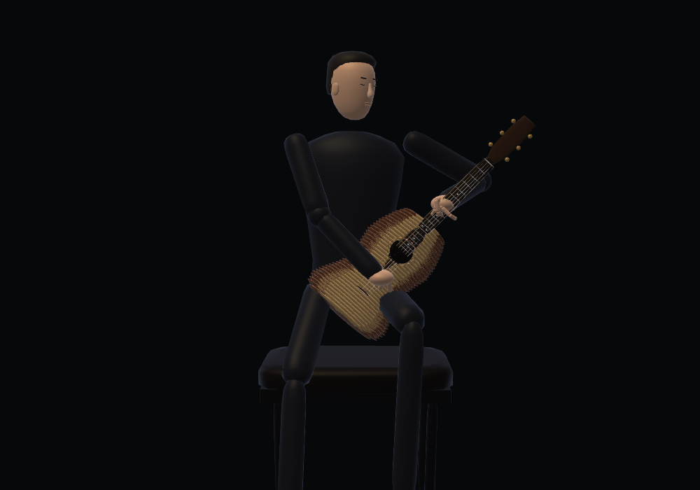
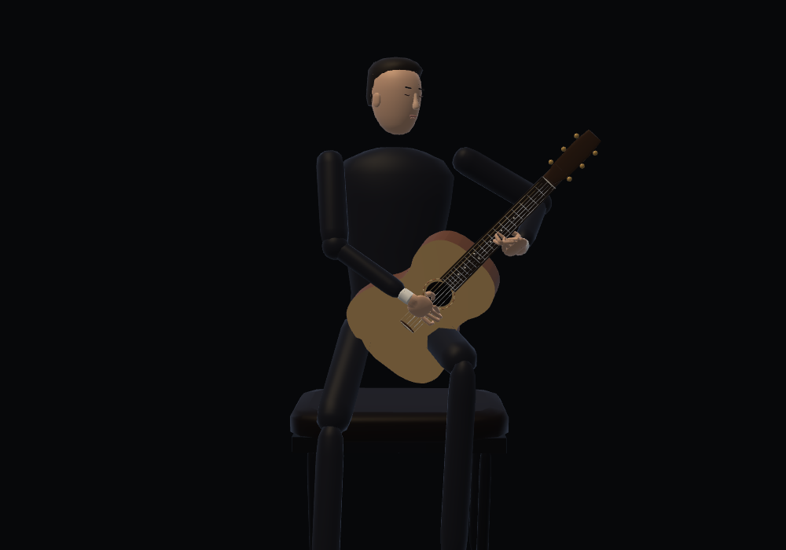
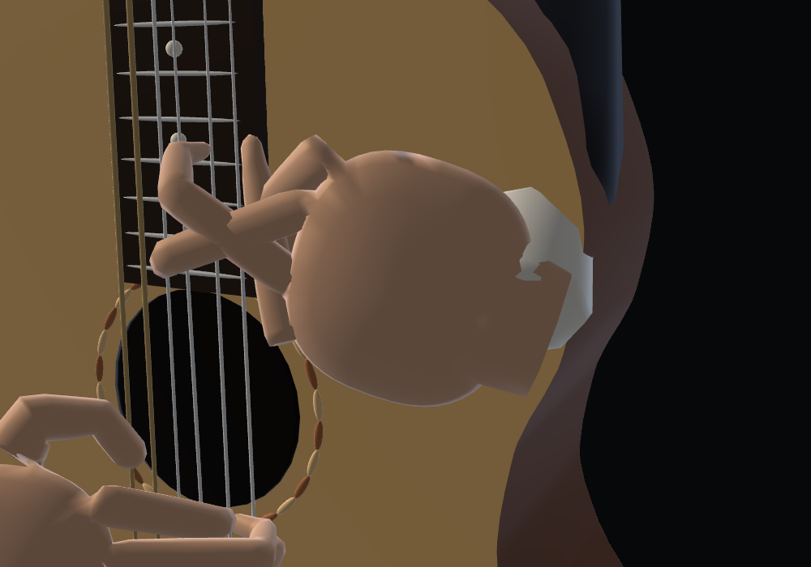

# Guitar: shared B hands and physical dimensions

Both hands use the piano's B anatomy: a 76 × 70 × 26 mm palm, fixed knuckle roots, four articulated fingers (75.2 / 84.8 / 79.2 / 63.2 mm) and a 71 mm thumb (30 / 23 / 18 mm bones). The first thumb bone lies mostly inside the palm. Each five-digit hand, palm and wrist forms one closed, connected surface with shared normals. The face mesh is unchanged; the geometry test pins its original vertex fingerprint.

The renderer reflects X. The fretting hand has the opposite anatomical frame from the plucking hand after that reflection. The left thumb supports the neck, fingers approach the strings from above, and the right thumb plays neckward of i–m–a. The right little finger remains relaxed rather than being planted on the soundboard.

## Instrument measurements

Measurements come from transformed renderer vertices, rather than parameter names alone. Units are millimetres.

| Measurement | Previous rendered model | Revised model |
| --- | ---: | ---: |
| String scale | 650 | 650 |
| Body length | 534.6 | 490 |
| Body maximum width | 360.6 | 370 |
| Body depth | 76.3 | 99 |
| Fingerboard width at nut | approximately 30 | 52 |
| Fingerboard width at fret 12 / end | — | 62 / 64 |
| Fingerboard length / thickness | 497 / 8.25 | 452 / 6 |
| Neck including fingerboard, nut / fret 12 | — | 21 / 23 |

The original 43 mm `nutWidth` described the string/nut bone span, not the actual fingerboard. The revised nut and board measure 52 mm. The board sits 6 mm above the soundboard; the soundhole follows the board end instead of lying under it. A tapered elliptical neck replaces the round shaft. A continuous top/back/rib mesh replaces 74 overlapping body slices with three static draw calls.

There is a real 20th-fret extension. Asturias contains simultaneous D♯5, F♯5 and B5 at 93.91302 and 301.76533 seconds. These need distinct strings; 19 frets cannot represent all three together. The new assignment uses string 3/fret 20 and a fret-19 barre on strings 1–2. All 9,709 original notes retain pitch, onset, duration and velocity; `guitar-note-hashes.json` pins their hashes against the previous main branch. Automatic strings and fingerings have been regenerated.

## Motion and resource lifetime

Each finger keeps its three bone lengths and canonical knuckle root. Barres can flatten the distal joints while preserving lengths. Index notes within a held/strummed barre share one target span. Note lists are ordered by actual onset, independent of pitch ordering inside chord events. Four-note chords may compress the positional fingering rule instead of assigning two strings to the same curved finger.

A six-coordinate wrist carriage is fitted offline, with analytic finger IK at playback. Compiled trajectories are checked against a source/fingering signature and a model stamp. Playback interpolates the carriage and never invokes the nonlinear fitter. Motion holds release a string when it is plucked again and release before a large position shift; source audio events are unchanged. This visual hold adaptation is separate from the synthesizer's plucked-string decay.

Each renderer owns two reusable dynamic hand buffers. Static instrument meshes are uploaded once. The shared skin's optional deformation callback leaves violin, cello and piano behavior unchanged. Near contact, soft tissue conforms to the board without changing bones.

## References

- [Yamaha CG series specifications](https://usa.yamaha.com/musical-instruments/guitars-basses-amps/products/classical-nylon-guitars/cg-cgx/specs.html): 650 mm scale, 490 × 370 mm body, 94–100 mm depth, 52 mm nut.
- [Yamaha classical guitar playing guide](https://www.yamaha.com/en/musical_instrument_guide/classical_guitar/play/): fretting-hand support and right-hand technique.
- [Ramírez neck dimensions](https://guitarrasramirez.com/en/the-art-of-the-guitar-neck-at-ramirez-stability-comfort-and-tradition/): contemporary 52.5 mm nut and approximately 20–24 mm neck depth.
- [Luthier Wilson Burnham: a 20th fret on a classical guitar](https://www.wilsonburnhamguitars.net/2021/03/20th-fret-on-classical-guitar.html): precedent for an extended classical fingerboard.

## Reproduction and reports

```sh
node precompute-guitar-plans.cjs
GUITAR_HAND_WORK=/tmp/guitar-hand-build node precompute-guitar-hands.cjs
node refine-guitar-clearance.cjs
node guitar-hand-test.cjs
node guitar-geometry-test.cjs
node guitar-skin-test.cjs
node guitar-continuity-test.cjs
NODE_PATH=/path/to/playwright/node_modules node guitar-hand-browser-test.cjs
```

The offline hand builder saves restartable work files. `GUITAR_HAND_SEED` may point to an earlier work directory for the same source notes; changed fingerings are fitted again.

The final audit covers 30,204 poses and all 9,709 source notes, with a maximum fretting error of 0.413 mm and fixed bone lengths. The skin audit covers 46,700 hand poses; maximum measured body/neck penetration is below 0.85 mm. The 75-second browser run keeps GPU buffer count constant at 41 with zero nonlinear fits and no JavaScript/WebGL errors.

Reports: [skeleton/contact/source notes](verification.json), [rendered dimensions and face](geometry.json), [rendered skin clearance](skin.json), [transition continuity](continuity.json), [75-second browser playback and instrument switching](browser.json). The transition test extrapolates displacement to a zero time interval to distinguish actual pose jumps from fast continuous motion; the animation remains an automatic interpretation of the MIDI. Clearance is sampled against actual indexed skin vertices and instrument geometry; it is not a proof for every possible interpolated time. Browser validation uses software WebGL and does not claim a physical-device listening test. Local integration checks cover the shell and all four instruments; byte comparison against separate sibling repositories requires those checkouts. The [local integration report](local-integration.json) excludes only that external comparison. [Regression reports](regressions.json) cover existing piano, audio, shared skin, violin and cello checks.

| View | Before | After |
| --- | --- | --- |
| Fretting hand |  |  |
| Plucking hand |  |  |
| Whole instrument |  |  |


