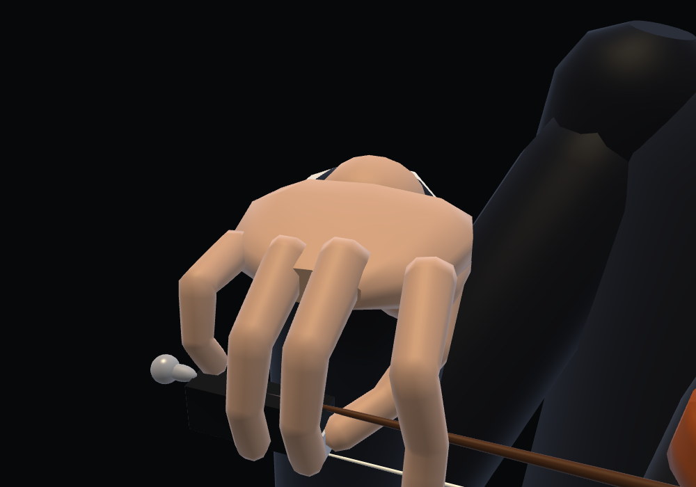
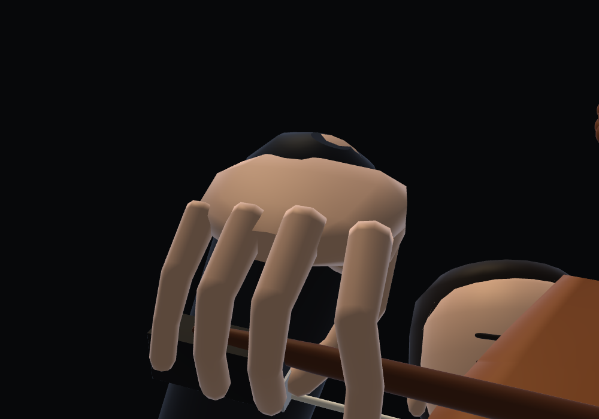
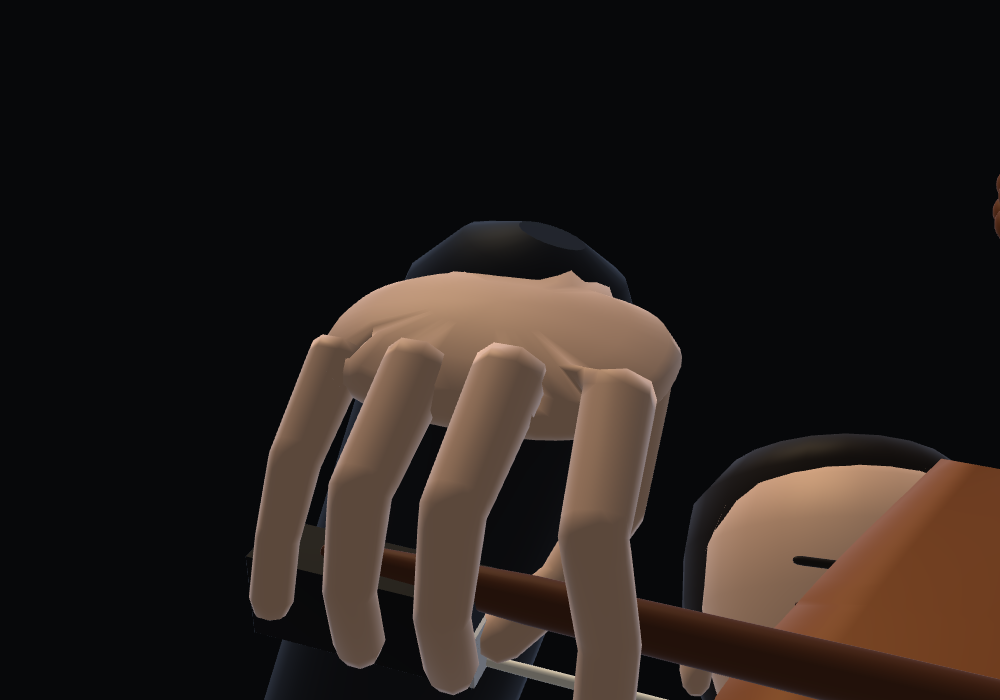
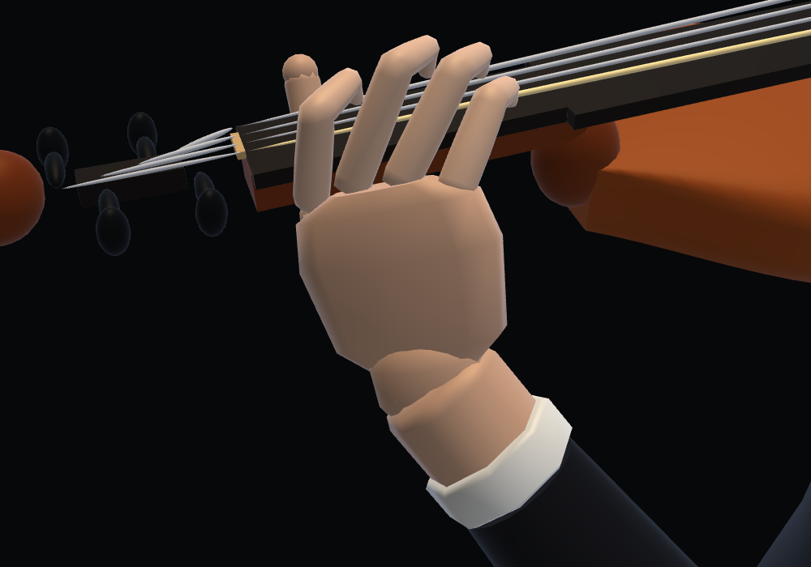
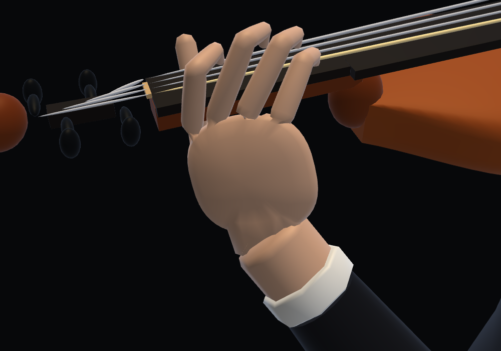

# Shared skin from fingers through palm to wrist

The violin left hand and the violin/cello bow hands now each have one connected
closed surface, including all five digits, the back/palm and the wrist. Finger
root caps are removed. Shared indexed collars connect the finger rings to
openings in the palm, and a shared wrist collar continues beneath the cuff.
Area-weighted normals span the joins, so they have no separate capped surfaces
or gaps. The palm uses the previous dimensions and a rounded contour.

The selected B finger lengths, thumb bone lengths, sounding/bow contact targets,
wrist/arm trajectories and face geometry remain unchanged. The left palm skin
can compress against the two rendered fingerboard boxes, without moving bones
or contacts. The instrument-side clearance test keeps its existing 1 mm limit.

Each complete hand uses 1,688 triangles and one draw call. Each right grip is
still constructed and uploaded once per instrument/renderer, then transformed
with the bow. The left hand retains one fixed dynamic buffer and one reused
121,536-byte upload array. Positions, normals, indices and seam connectivity are
allocated once; seam phase is selected at initialization and stays fixed.

| Violin right, before | Connected hand |
|---|---|
|  |  |

| Cello right, before | Connected hand |
|---|---|
|  |  |

| Violin left, before | Connected hand |
|---|---|
|  |  |

Verification:

- `node hand-surface-test.cjs`: 1,010 poses across all three affected hands.
  Every referenced vertex belongs to one connected component; every edge has
  two oppositely wound incident faces; Euler characteristic is 2. All finger
  roots share edges with the palm collars. Normals are unit length, vertices
  are finite, scratch arrays retain identity, and hand input is not mutated.
- Existing skin tests check GPU reuse for 4,500 frames: one allocation followed
  by updates for the left hand; two static uploads in total for both right
  grips, with no subsequent upload/update and one draw per complete hand.
- Left-hand contact/fixed-bone/continuity checks pass across 10,261 states.
  The sampled rendered skin stays below 1 mm overlap with board/neck/body.
  Bow contact and arm checks still pass; face draw-data fingerprints match.
- Chromium close-ups and full scenes check both low/high violin positions and
  both bow hands. The 75-second shell playback check verifies continued audio
  clock progression, stable GPU buffer count, no GL/page errors, and switches
  among three violin pieces and all four instruments.
- Local integration checks and the standalone HTML/ZIP build pass. External
  source-repository byte comparisons need separate checkouts unavailable here.

The closed-surface test proves connectivity, not absence of every possible
self-intersection. Instrument clearance is sampled at vertices. The wrist end
is capped underneath the existing cuff; sleeves remain separate meshes.
