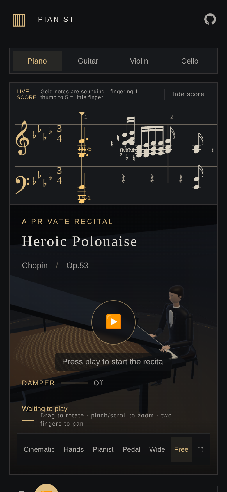

# Mobile camera gestures

Pinch to zoom and drag with two fingers to move the camera and its target together in the screen plane. Either gesture enters Free Camera from the current rendered view, including close-ups. One-finger rotation and mouse drag/wheel remain available in Free Camera. Selecting a camera preset restores its framing.

The piano and the three string instruments share `camera-gestures.js`. Each renderer supplies its current eye, target and up vector. This retains the piano's overhead orientation and accounts for the renderer's X reflection and mobile framing. Pan distance is calculated from the viewport's CSS height, the field of view and camera distance. Camera and target translate by the same vector; panning does not rotate the view.

Two-finger moves are calculated from the gesture's original pose and midpoint, so sequential pointer events do not accumulate pinch drift. Zoom is anchored on the view's target plane beneath the fingers. Distance is bounded to 0.15–25 physical metres. Finger-count changes rebase the gesture; cancellation, capture loss, resize, blur and instrument switching discard stale drag state. Only the active instrument consumes input.

The controls keep touch handling within the canvas. Page scrolling and zooming elsewhere retain normal browser behavior. Camera buttons, playback controls and the score remain separate controls.

Verification:

- [Native gesture regression](gestures.json): screen-parallel pan in front and overhead views, off-centre pinch anchor, zoom bounds, pointer ordering, third-finger transitions, cancellation, capture loss and inactive clients.
- [Mobile browser regression](browser.json): Chromium with a 390 × 844 touch viewport and actual CDP touch events. All four instruments support two-finger pan, pinch, release without snapback, one-finger rotation and preset reset. The test also checks interrupted instrument switching, mouse drag/wheel, and JavaScript/WebGL errors. This is browser emulation rather than a physical iOS/Android device test.
- [Piano playback/clock regression](piano.json) and [local shell integration](local-integration.json). The latter omits only byte comparison against external sibling repositories that are not checked out.



```sh
node camera-gestures-test.cjs
node verify.cjs
NODE_PATH=/path/to/playwright/node_modules node camera-gestures-browser-test.cjs
python pack-v8.py
```
