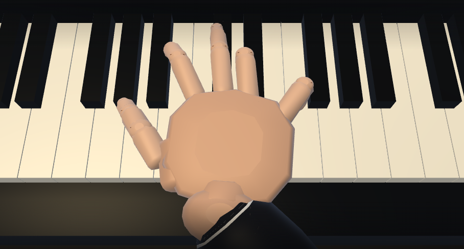
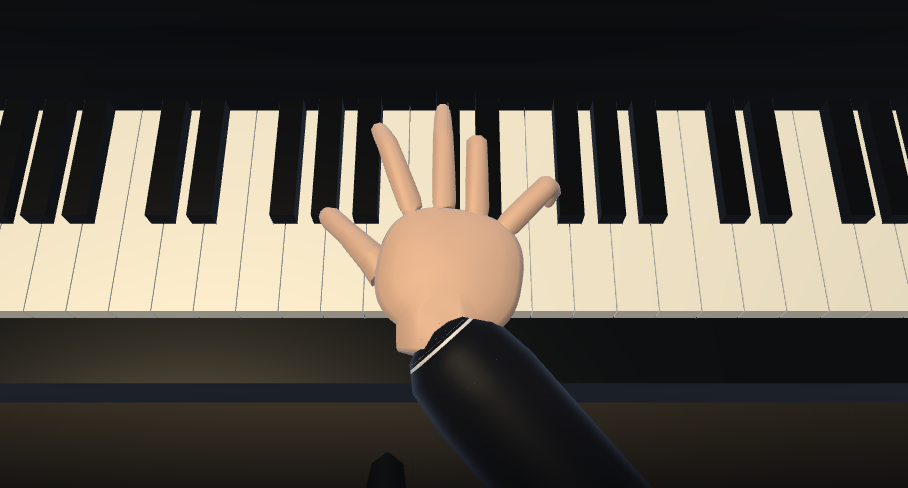
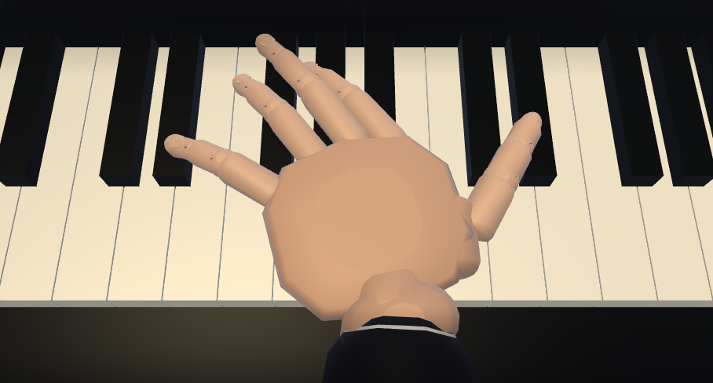
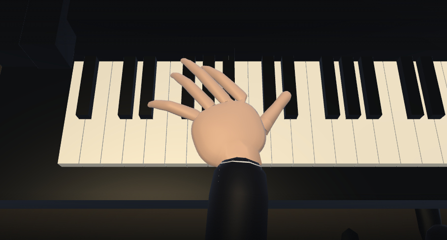

# Piano hands using the shared B anatomy

Both piano hands now use the violin left-hand B fingers/palm and continuous surface,
mirrored anatomically. This changes the skeleton and dimensions as well as the
skin. Thumb/index/middle/ring/little bone lengths total 71 / 75.2 / 84.8 / 79.2 /
63.2 mm. Palm half-extents are 38 / 35 / 13 mm; The four MCP roots match the wrist-rooted
violin hand. The thumb uses 30/23/18 mm bones with its CMC nearer the wrist;
The proximal metacarpal is enclosed by the palm/thenar surface, leaving the
visible thumb shorter than the fingers. All five digits, palm and wrist share one closed surface, 1,688
triangles per hand. The face meshes keep their reviewed fingerprints.
The piano renderer normalizes the old 1.617 scale so white-key pitch is
23.5 mm, white-key length 148 mm and black-key length/width 95/14 mm. Body,
piano, cameras and lighting use the same conversion; the physical hand meshes
are not scaled twice. Facial geometry/proportions remain unchanged.

Each piano hand reuses one dynamic GPU buffer and a fixed upload array.
`piano-skin.js` adapts the existing musical joints to the shared mesh builder;
it does not fit hand poses or allocate new meshes while playing.

## Playing with the smaller hand

The Royal Conservatory describes redistribution, discreet chord rolling and
damper-pedal connection as valid adaptations for small-handed pianists:
[Ask an Examiner](https://teacherportal.rcmusic.com/Q-As/Ask-an-Examiner/Question-Regarding-Dealing-with-Students-with-Smal).
Deahl and Wristen also discuss dividing/rolling chords and releasing notes in
[Adaptive Strategies for Small-Handed Pianists, chapter 6](https://academic.oup.com/book/4752/chapter-abstract/147003618).

Following the user's choice to use actual performance techniques, unreachable
chords are played as compact consecutive groups, low to high. Sound, key motion
and hand contacts use the same performed timings. All 30,639 source pitches,
velocities, hand assignments and finger numbers remain; notes are not omitted.
After correcting the piano/hand scale, only two additional chord groups (Gymnopédie)
need a split: four onsets move by at most 40 ms, with two short pedal bridges. Existing pedal levels
are retained beneath these bridges. A bridge ends before the next attack;
it is not an unrestricted sustain layer. Rolled notes release with the fingers.
Other source onsets are retained. The score keeps the written chord positions and adds an arpeggio mark;
sounding noteheads follow the performed onsets.

This is an automatic adaptation, not a hand-edited concert arrangement.
The onset/pedal changes are intentional and audible; this replaces the earlier
idea of keeping the sound unchanged while rolling only the animation.

`precompute-piano-hands.cjs` fits all hand positions offline from the reviewed
`piano-hand-template.json`. It has restartable work files, stamps its outputs
against code/template signatures, and writes the performed song trajectories.
Regenerate with `node precompute-piano-hands.cjs`; prepared hand positions are
retained wherever the resized hand can cover them. Runtime playback uses the
compiled trajectories. Source V6 hashes remain preserved in the template;
`piano-performance-hashes.json` pins the reviewed performed notes and pedal data.

## Same-camera comparison

| Right, before | Shared B hand |
|---|---|
|  |  |

| Left, before | Shared B hand |
|---|---|
|  |  |

## Verification

- `piano-hand-test.cjs`: all 18 pieces, mirrored shared roots and fixed bones,
  closed connected topology, shared normals, finite vertices and unchanged
  musical pose inputs. Pitches/fingerings, onset bounds and cache stamps are
  checked. 4,500 frames allocate exactly two GPU buffers once, then update the
  same two arrays; one draw per hand.
- `verify.cjs`: audio/key/score clocks, fixed skeleton, contact and wrist/arm
  connections, continuous frames, pedal/heel, and UI regressions. Anatomy,
  relaxed-finger, technique-preference, score and pedal checks also pass.
- Chromium/SwiftShader: 75 seconds of actual piano playback, continued progress
  past a minute, stable two-buffer skin, no GL/page errors, bounded audio voices
  and debug history, paused audio suspension, song and instrument switching.
- Geometry tests retain the original face fingerprints in both renderers;
  string-hand regression and local shell integration checks remain covered.
  Source-repository byte comparisons need separate checkouts unavailable here.

Tests sample contacts and topology; they do not prove absence of every skin
self-intersection or instrument collision. Playback tests check resource reuse
and clock progression, not listening on the originally reported device.
Full scene measurements: [geometry-budget](../geometry-budget/README.md).
