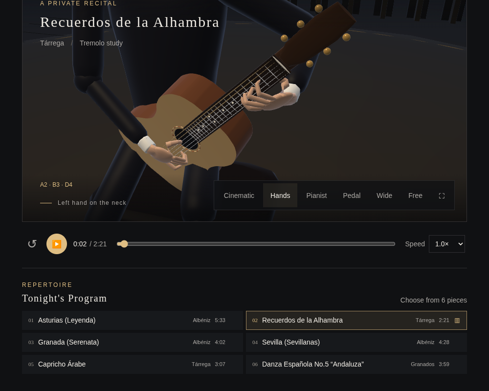
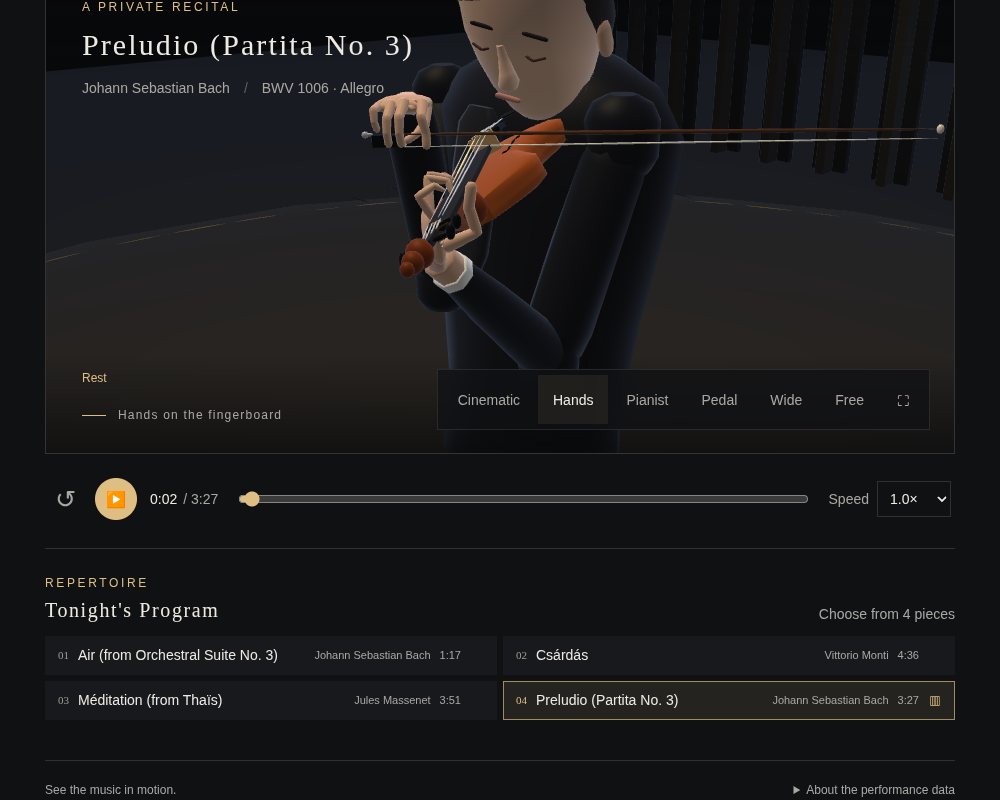

# Alhambra fingering and fast violin repertoire

`Recuerdos de la Alhambra` retains every original note, onset, duration and
velocity. The former global pitch-based classifier missed its tremolo and
assigned accompaniment to i/m. An explicit rhythmic texture now assigns the
eighth-note accompaniment to p and rotates the melody through a–m–i.

The opening E is string 2 / fret 5 / finger 4, followed by the second-string
third- and first-fret melody. Explicit finger/string numbers from the licensed
score become indexed hints, with repeated-pitch continuation. Equivalent
reuse of an existing index barre remains possible. Two short visual releases
let finger 2 take over while the index leaves its barre. The original audio
and score durations are retained.

The right-hand carriage is also fitted for thumb attacks on strings 2–6;
Alhambra's high inner voice can use the thumb on string 2. The former
bass-only thumb fit missed that string by about 7 mm. The updated fit checks
the thumb and the three plucking fingers without altering finger lengths.

The violin has four pieces, including the complete **Bach Partita No. 3,
Preludio, BWV 1006**: 1,635 notes, quarter = 120, about 3:27 including the
tail. The source's meter and key and all note pitches/velocities are retained.
Our separate-stroke realization alternates 1,629 strokes; MIDI does not encode
the engraved slurs. This adaptation is described in the source notes.

Both pieces ship offline hand trajectories. The violin uses the existing B
fingers and anatomical left grip; resting fingers and the elbow are fitted
against the fingerboard/body. Repertoire changes introduce no runtime fitter.

Sources, attribution, licences, interpretation details and regeneration steps:
[repertoire-sources/README.md](../../../repertoire-sources/README.md).

Checks:

- [Music regression](music.json): all six guitar note hashes, unchanged plans
  for the other five guitar pieces, opening TAB/left-hand fingering, every
  accompaniment attack, complete a–m–i sequence, source hints, barre handoffs,
  source MIDI equality, score tempo, bow changes and playable violin strings.
- [Guitar hand](guitar-hand.json), [rendered skin](guitar-skin.json),
  [finger clearance](guitar-clearance.json), [continuity](guitar-continuity.json).
- [Violin hand](violin-hand.json): exact contacts, fixed bones, anatomical
  chirality, continuous wrist/elbow, and actual rendered skin versus wood.
- [Browser playback](browser.json): both pieces produce synthesized audio,
  transport advances, seeking works and WebGL/JavaScript errors are absent.
  Audio waveform output is measured; this is not a human listening review.
- [Audio lifecycle](audio.json): retired voices disconnect and history stays
  bounded. [Local integration](integration.json) exercises all song selections;
  external sibling-repository byte comparison is omitted because those repos
  are not checked out in this workspace.




```sh
node repertoire-test.cjs
node guitar-hand-test.cjs
node guitar-skin-test.cjs
node guitar-finger-clearance-test.cjs
node guitar-continuity-test.cjs
node violin-left-hand-test.cjs
NODE_PATH=/path/to/playwright/node_modules node repertoire-browser-test.cjs
python pack-v8.py
```
