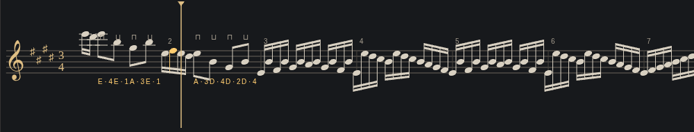
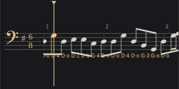
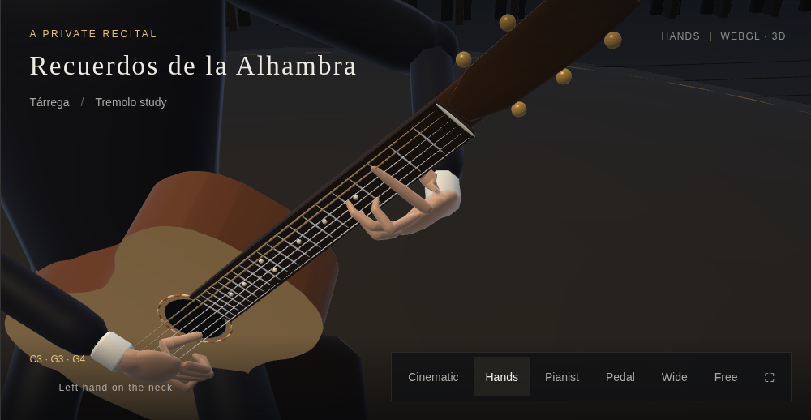

# String-score beams and Alhambra chord shapes

Violin and cello short notes now share stems and beams within each beat.
Compound meters such as 6/8 use dotted-quarter groups. Beam groups are built
once for the complete score, so scrolling cannot change their membership.
Rests, quarters, beat boundaries and clef changes break groups. Mixed eighth,
sixteenth and shorter values retain secondary beams and hooks. Simultaneous
chord notes share one stem. This remains an automatic performance transcription.

Alhambra formerly released fretting fingers for individual plucks and derived
its wrist position from each note. Its source hints also carried a pitch's
fingering into unrelated bars. The replacement reads written bar positions and
tuplets from the licensed edition, then selects a joint string/finger shape
within each position region. Source string and barre constraints are retained;
finger numbers are preferences when a shared playable shape needs another
finger. The first 54 bars contain 60 regions. Adjacent identical shapes share
one hold, including the CIII chord across bars 7–8. The final three coda bars
continue through the ordinary engine.

The left hand holds stops independently of right-hand attacks. Lower stops may
remain beneath higher notes, while higher stops lift for lower or open notes.
One common carriage is fitted offline per region; transitions are refined
against rendered skin and finger clearance. No fitting runs during playback.
Original pitches, onsets, durations and velocities are unchanged.

Measured wrist range within stable parts of each bar (millimetres):

| Bar | Before | After |
| --- | ---: | ---: |
| 3 | 39.244 | 0 |
| 7 | 5.862 | 0 |
| 8 | 5.862 | 0 |
| 23 | 37.933 | <0.00001 |
| 24 | 36.897 | <0.00001 |

Checks:

- [Beam fixtures](beams.json): simple/compound meters, rests, mixed flags,
  bar/clef/meter boundaries, chord stems and scrolling.
- [Musical grip regression](grips.json): all 1,338 attacks have the correct
  highest pressed fret on the played string, including open strings; held
  fingertips and wrists remain still in stable chords; all five other guitar
  pieces retain exact performer poses at 17 samples each.
- [Hand geometry](hand.json), [finger clearance](clearance.json),
  [rendered skin](skin.json), [continuity](continuity.json): fixed bones,
  playable contacts, minimum 4.5 mm bone clearance, wood penetration within
  1 mm and continuous transitions. Runtime fits: zero.
- [Browser](browser.json): all four violin and four cello songs show beams at
  1100 and 390 px widths; Alhambra bars 3/7 have stationary wrists. No page or
  WebGL errors. Chromium uses software WebGL; physical phone testing and a
  human listening review were not performed.
- [Repertoire](repertoire.json): original guitar note hashes, source mapping,
  p–a–m–i roles, other five guitar plans and Bach source MIDI preservation.
- [Integration](integration.json): all instruments and selections; sibling
  repository byte comparison omitted because those repos are not checked out.





Sources, attribution and interpretation limits:
[repertoire-sources/README.md](../../../repertoire-sources/README.md).

To regenerate Alhambra from the shipped combined cache:

```sh
node build-repertoire.cjs
node precompute-guitar-plans.cjs
node precompute-alhambra-grips.cjs
node refine-guitar-clearance.cjs recuerdos
```

The common-grip builder preserves the other five songs and right-hand data.
Always run clearance refinement after it. To verify and package:

```sh
node string-score-beams-test.cjs
node score-test.cjs
node guitar-chord-grip-test.cjs
node repertoire-test.cjs
node guitar-hand-test.cjs
node guitar-finger-clearance-test.cjs
node guitar-skin-test.cjs
node guitar-continuity-test.cjs
NODE_PATH=/path/to/playwright/node_modules node string-score-grips-browser-test.cjs
python pack-v8.py
```
