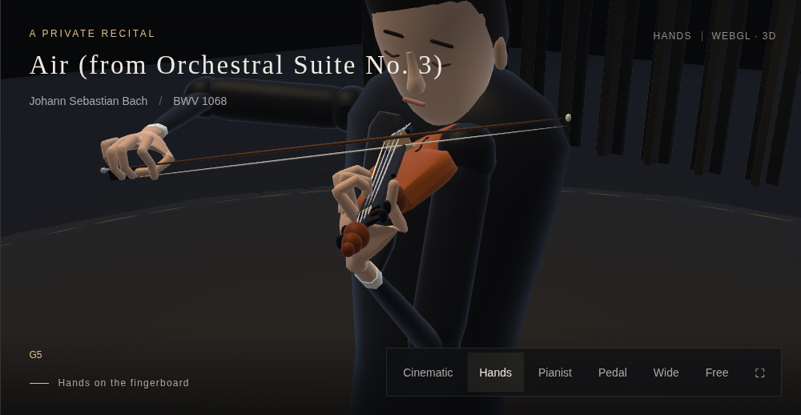
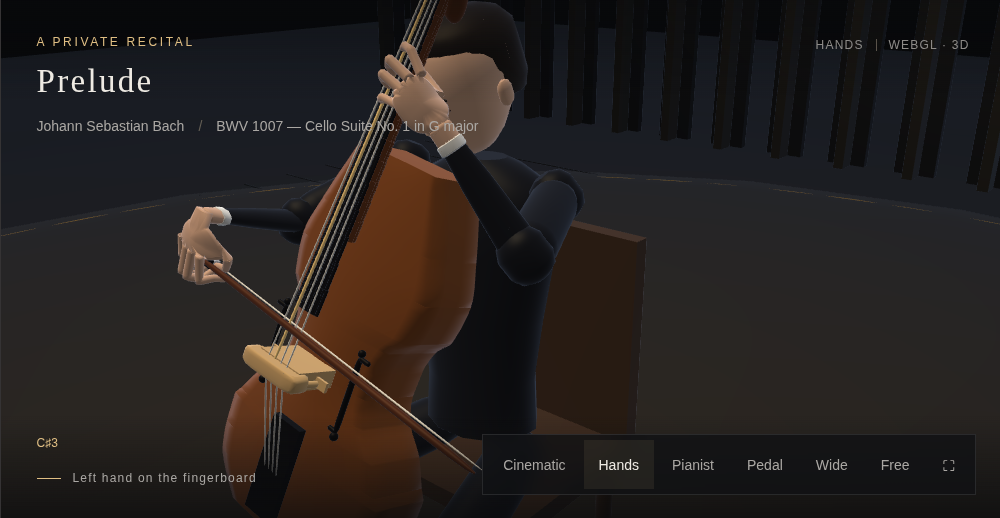
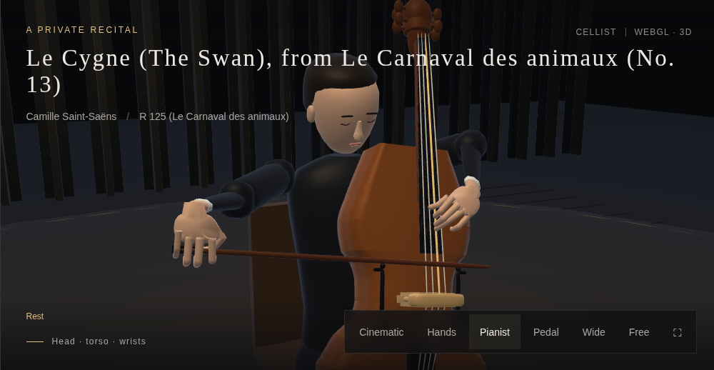

# Cello-reference hands and symmetric, shorter arms

The [distal-thumb follow-up](../thumb-distal/README.md) shortens IP-to-tip to 60%; its images supersede the original PR #23 browser snapshots below.

The cello and violin formerly used different left-hand dimensions. Their bow
hands shared a third, smaller set of bones. All four hands now use the cello
natural-hand lengths and its selected 0.65 radius profile, from one dimension
table in `dist/instruments/bow-hand.js`.

| Finger | Former violin left total (mm) | Common total (mm) | Common radii, root / middle / tip (mm) |
| --- | ---: | ---: | --- |
| Index | 75.2 | 93 | 8.45 / 7.80 / 6.825 |
| Middle | 84.8 | 100 | 9.10 / 8.45 / 7.15 |
| Ring | 79.2 | 97 | 8.775 / 8.125 / 6.825 |
| Little | 63.2 | 76 | 7.475 / 6.825 / 5.85 |

The thumb uses **46 + 34 + 16.2 mm** bones and **9.425 / 8.775 / 7.475 mm**
radii in both instruments and on both hands. Its 96.2 mm total includes the
46 mm metacarpal inside the hand; the two visible phalanges total 50.2 mm.
The metacarpal shaft is covered by a broad thenar sheet from the palm/back
surface. Only the last 5% of its tube remains inside that sheet. Palm, thumb,
fingers and wrist are one closed indexed mesh, with shared normals: 846
vertices, 1,688 triangles, one component, zero boundary edges per hand.
The former cello web rod and separate overlapping skin pieces are removed.

The four finger lengths remain exact at playback. Cello's Cartesian pose-cache
interpolation had shortened a segment by up to about 0.8 mm in the measured
baseline; an analytic two-bone construction now restores each fixed chain
about its original fingertip cap. It preserves the cap contact, requires no
iterative pose fitting, and does not append frame history.

Both upper arms and forearms are **8% shorter**:

| Performer | Upper arm (mm) | Forearm (mm) |
| --- | ---: | ---: |
| Violin | 331.2 | 312.8 |
| Cello | 276.0 | 257.6 |

The left and right use identical dimensions within each performer. Both
instruments call the same arm/sleeve/cuff renderer: identical upper sleeve,
elliptical forearm, wrist bridge, white cuff and joint shapes. The sleeve
rotates with its hand. At the far end of a cello bow stroke, a small shoulder
reach maintains contact without stretching an arm bone.

The larger fingers retain their nominal thickness; soft contact tissue can
flatten against the wood. Violin clearance uses external faces of the union
of the overlapping fingerboard and neck boxes, avoiding a projection that
bounces between their internal faces. Cello skin conforms to its curved
fingerboard/neck distance field. These operations deform the surface only;
bone lengths, contact targets and mesh connectivity remain unchanged.
Faces, instrument sizes and musical note data are preserved.

Verification reports:

- [Common dimensions, rendered radii, fixed bones, sleeve symmetry and cello wood clearance](dimensions.json).
- [All four closed hand meshes](surface.json), [bow contact](bow.json), [actual bow skin contact and static GPU reuse](bow-skin.json).
- [Violin hand contacts and rendered wood clearance](hand.json), [67,084-time motion audit](motion.json), [dynamic GPU reuse](skin.json).
- [Face geometry and instrument silhouettes](geometry.json), [integration](integration.json). The integration run omits only byte comparison with absent sibling repositories.
- [Browser images and 75-second playback for each instrument](browser.json). Software WebGL; physical-phone and auditory review are not included.





Rebuild the violin joint angles from the shipped carriage track, then refit
elbows and use the rendered geometry tests as the acceptance oracle:

```sh
cp dist/instruments/violin-hand-frames.js /tmp/string-hand-template.js
VIOLIN_HAND_WORK=/tmp/string-hand-work node precompute-violin-hand.cjs --retarget-from /tmp/string-hand-template.js --reuse-carriages --resume-angles
node precompute-violin-orientation.cjs
node string-player-proportions-test.cjs
node violin-expression-test.cjs
node violin-left-hand-test.cjs
node hand-surface-test.cjs
node bow-hold-test.cjs
node bow-skin-test.cjs
node violin-skin-test.cjs
node geometry-test.cjs
NODE_PATH=/path/to/playwright/node_modules node string-player-browser-test.cjs
python pack-v8.py
```

The cello cache continues to supply the original musical hand positions; fixed
bone restoration and shortened-arm reconstruction apply as bounded analytic
steps on the cached pose. The conservative circular arm capsule guide in the
offline violin builder can report a collision even when the actual tapered
oval sleeve clears the violin; final acceptance uses the rendered vertices.
