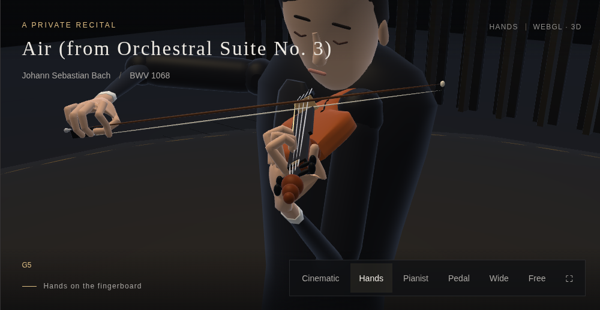
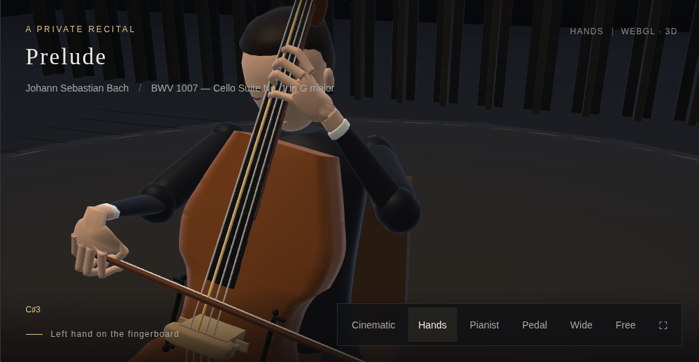

# Distal thumb at 60 percent

The shared IP-to-tip bone is shortened from 27 mm to **16.2 mm** in both
hands of the cello and violin. The metacarpal (46 mm), proximal phalanx
(34 mm), thumb radii, other fingers, arms and face are preserved.

Bow grips are solved once about the same frog contacts. The violin left
thumb keeps its neck-support joint and direction. For the cello's existing
27 mm pose stream, the original proximal chain is restored before resizing
the last bone and its cap, preserving the supporting IP joint. Future cache
streams can specify `source.thumbDistalLength` in metres.

[Dimensions and fixed bones](../string-player-proportions/dimensions.json),
[closed surfaces](../string-player-proportions/surface.json),
[bow skin contact](../string-player-proportions/bow-skin.json),
[violin hand clearance](../string-player-proportions/hand.json) and
[motion](../string-player-proportions/motion.json) are rerun for this change.
[Browser snapshots](browser.json) cover five performance positions, both
instruments and hand/portrait cameras. No physical-phone or listening test.




```sh
STRING_PLAYER_VERIFICATION_DIR=docs/verification/thumb-distal NODE_PATH=/path/to/node_modules node string-player-browser-test.cjs --poses-only
```
