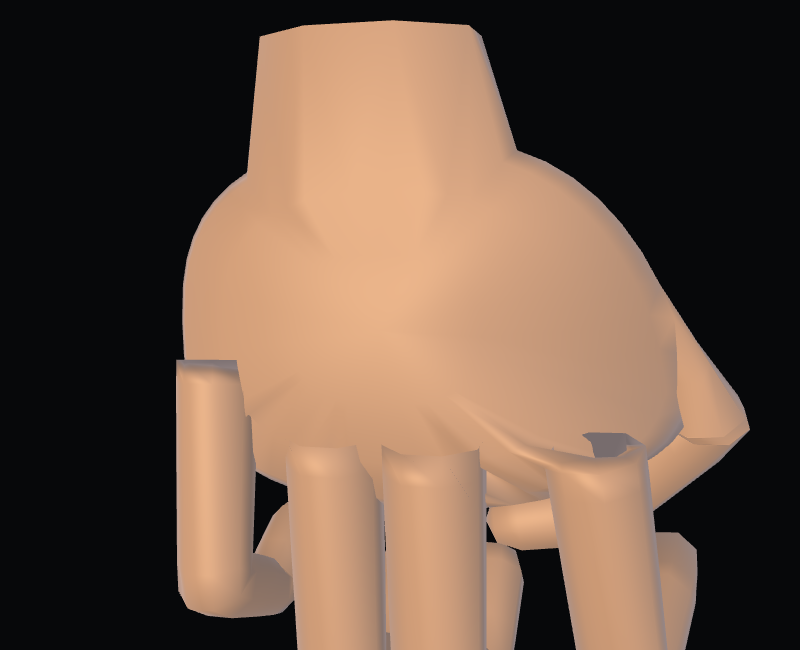
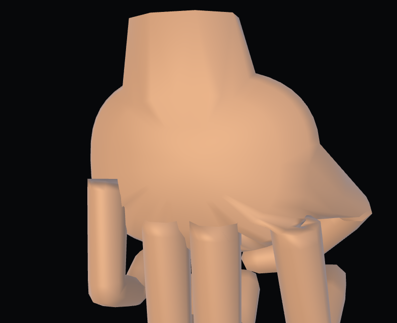
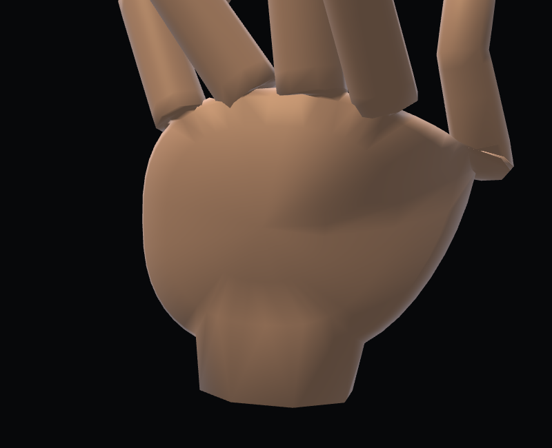
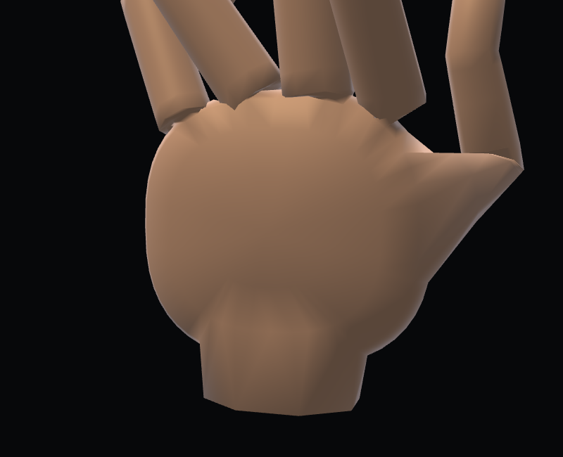
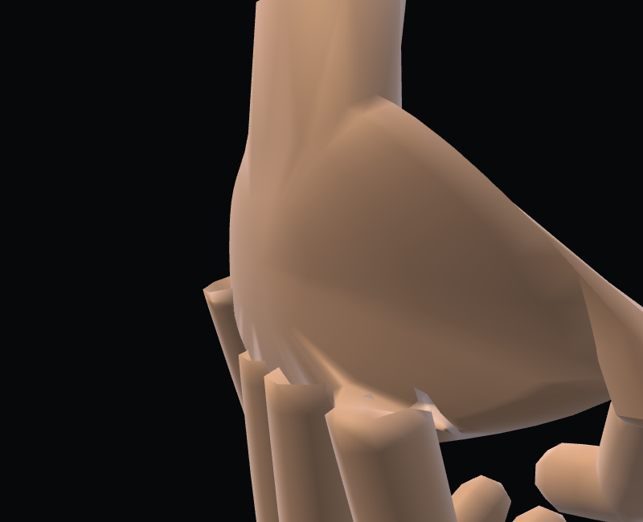
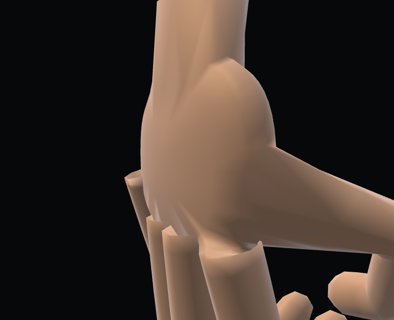

# Palm-to-thumb skin continuity

The former six-vertex thumb socket pinched the skin into a narrow bridge.
Pulling existing palm vertices toward the metacarpal also folded the surface.
The bow hand socket lay toward the wrist, while the metacarpal exited toward
the fingers, so its connecting faces passed across the palm.

Covered string hands now use a broader socket on the correct side. The
thumb socket's phase is matched against all eight root-ring directions,
keeping the connecting strip untwisted. The older palm-pulling deformation
is bypassed for this mesh. The dorsal palm stays continuous into the thenar
region. These are welded surface triangles, with shared normals, rather than
a separate piece covering the seam. Piano and guitar retain their existing
socket geometry. Finger/thumb bones, the selected 16.2 mm distal thumb,
radii, musical contacts, arms and face are preserved.

Verification:

- [Socket direction and bridge area](connection.json): canonical bow meshes
  place the thumb opening on the radial, palmar, fingerward side. The
  intermediate ring retains at least 100 mm² of area.
- [All four closed surfaces](surface.json): one connected component, zero
  boundary edges, consistent winding, unit normals and reused storage.
  Left hands use 1,654 triangles; bow hands use 1,666 (previously 1,688).
- [Dimensions and cello clearance](dimensions.json), [violin hand clearance](hand.json),
  [bow surface contact and GPU reuse](bow-skin.json), [dynamic reuse](skin.json),
  [face and instrument geometry](geometry.json).
- [Isolated closeups](after.json) use the actual model/bow drawing paths;
  [performance scenes](scenes.json) check five positions in both instruments.
  Software Chromium; no physical-phone or auditory review.

| Previous | Revised |
| --- | --- |
|  |  |
|  |  |
|  |  |

```sh
node thumb-web-test.cjs
node hand-surface-test.cjs
node string-player-proportions-test.cjs
node violin-left-hand-test.cjs
node bow-skin-test.cjs
NODE_PATH=/path/to/node_modules node thumb-web-browser-test.cjs
STRING_PLAYER_VERIFICATION_DIR=docs/verification/thumb-web NODE_PATH=/path/to/node_modules node string-player-browser-test.cjs --poses-only
```
