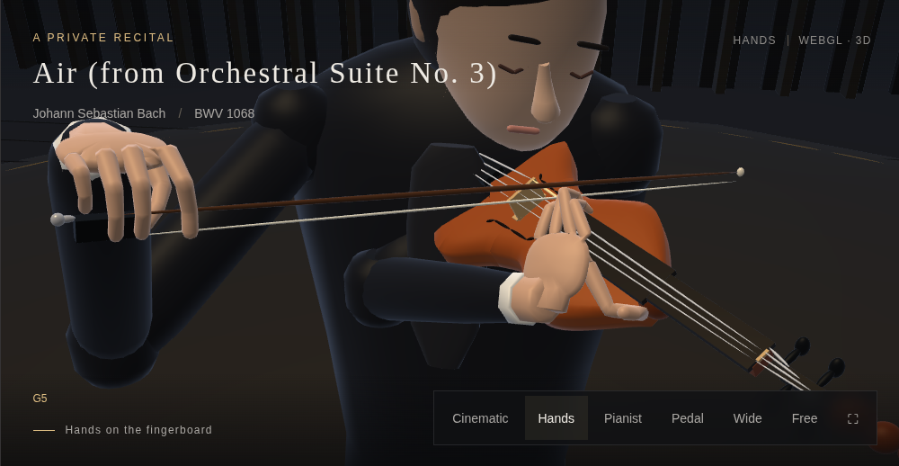
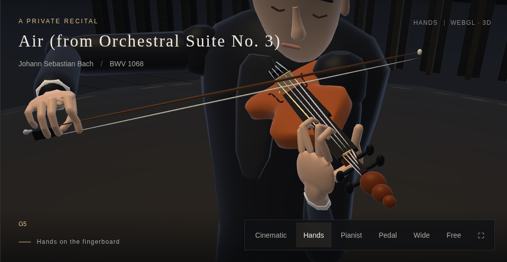
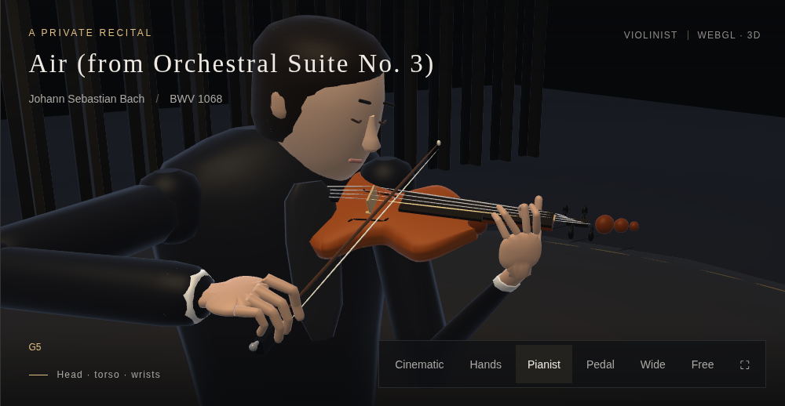

# Violin wrist posture and upper-body phrasing

The former trajectory could fold the left wrist beyond 90° and carry the
elbow across the torso. The hand already had left-hand chirality, but the
forearm approached the palm from behind its distal axis, making it look like
a reversed neck grip. The left shoulder now sits forward on the jacket and
protracts further in high positions. An offline elbow sweep keeps the elbow
outside the torso while checking the actual sleeve vertices against the body.
Existing finger placements and bone lengths are retained. Two Preludio
transition carriages were also corrected; every knot is checked from both sides.

The final motion audit covers 67,084 times in all four pieces: maximum wrist
angle 80.98°, minimum left elbow side distance 83.35 mm and minimum right
elbow opening 82.11 mm. The original overall maximum was 92.23°.
These are model-space measurements, not prescribed human joint angles.

The shipped Air retains Bach’s original D-major register. Its former G-string-only
constraint applied the premise of Wilhelmj’s transposed C-major arrangement
to the wrong pitches, forcing unnecessary 12th–14th positions. Removing that
constraint keeps all 149 notes unchanged and uses normal A/E-string fingerings
in first position. See [LA Phil’s programme note](https://www.laphil.com/works/air-on-the-g-string).

A cached carriage stores 12 wrist/thumb/swivel coordinates and a separate
array of finger angles. Previously, reusing that compact carriage as a solver
seed omitted the finger angles. The solver now reconstructs the complete
seed before refining a stored pose.

The sleeve and wrist bridge use an oval section aligned with the hand,
matching the narrower depth of the connected hand surface. The former
circular bridges could force an otherwise valid wrist away from the violin.
The renderer and independent wood-clearance audit now share the same forearm
drawing path, including the cuff. Bone lengths and polygon counts are retained.

The bow elbow opens to the player's right rather than hanging down. Its
height follows the played string. The left shoulder moves forward in
higher positions, allowing the elbow to approach beneath the hand. Arms keep their fixed lengths and the
five-digit bow grip stays attached to the frog.

The chest, shoulders, head, instrument, bow and both hands share an upper-body
parent frame about the hips. Slow phrase motion combines with musical energy
and filtered bow reach. A two-stage low-pass filter prevents fast bow strokes
from shaking the torso. Legs retain their standing support. This parent is
applied to both ordinary geometry and dynamic hand skins, then restored before
stage/other-instrument drawing. Rigid transforms preserve bow/string and
finger/string contact, skin clearance and bone lengths. The face mesh and
instrument proportions are unchanged.

Verification:

- [Before measurements](before.json), [current motion checks](motion.json):
  all four pieces, wrist orientation, sideways bow elbows, arm lengths,
  world-space musical contact, continuous upper-body motion, actual renderer
  matrices for static/dynamic geometry, and parent restoration after errors.
- [Left hand](hand.json): fixed bones, contacts, chirality, knot continuity and
  actual rendered skin versus instrument wood.
- [Connected hand skin](surface.json), [finger skin/GPU reuse](skin.json),
  [bow grip](bow.json), [bow skin](bow-skin.json).
- [Geometry](geometry.json): face geometry/normals/colors unchanged; instrument
  silhouette and polygon budget retained.
- [Browser](browser.json): high-position views in all four songs, upper-body
  views, real playback, shared parent rendering, bounded GPU buffers and no
  JavaScript/WebGL errors. Software WebGL; no physical-phone or human listening
  review.
- [75-second playback](playback.json): bounded GPU buffers, no nonlinear hand fits, song/instrument switching and no WebGL errors.
- [Local integration](integration.json): all instruments and song selections;
  sibling-repository byte comparison omitted because those checkouts are absent.

| Previous high position | Revised high position |
| --- | --- |
|  |  |



Refit the elbow track from the shipped combined hand cache, then verify:

```sh
node precompute-violin-orientation.cjs
node violin-expression-test.cjs
node violin-left-hand-test.cjs
node violin-skin-test.cjs
node hand-surface-test.cjs
node bow-hold-test.cjs
node bow-skin-test.cjs
node geometry-test.cjs
NODE_PATH=/path/to/playwright/node_modules node violin-expression-browser-test.cjs
NODE_PATH=/path/to/playwright/node_modules node violin-skin-browser-test.cjs
python pack-v8.py
```

Hand fitting runs only in the offline builders. Playback interpolates the
compiled track and the finite, per-song expression track. Seeking does not
append history or run nonlinear fitting. These are stylized performance
poses, not a claim of ideal teaching posture at every transition.

Photo references inspected (photos were viewed for research and are not bundled):

- [University of Texas String Project: position and posture](https://music.utexas.edu/string-project/parent-resources/string-project-position-posture): low/high-position left-hand photographs; a free elbow beneath the instrument and a neutral forearm-to-hand line.
- [Kathleen DeBerry Brungard, Midwest Clinic 2010: The Expressive Bow](https://www.midwestclinic.org/user_files_1/pdfs/clinicianmaterials/2010/kathleen_deberrybrungard.pdf), page 4: photographs of A/D/G bow-arm levels; the G-string arm is higher.
- [Andy Tan: left-hand posture and geometry](https://www.andytanviolin.com/resources/left-hand-posture-and-geometry/): supporting thumb, neutral wrist and elbow rotation for string crossings.
- [Orchestra Mentor: Posture Part 1](https://www.orchestramentor.org/post/posturepart1): first/higher-position photographs, including a front view of the elbow beneath the forearm.

Elbow placement changes with string and position. The model opens the left
elbow away from the torso while preserving its support below the instrument;
it does not impose a permanently raised or fully lateral upper arm.
