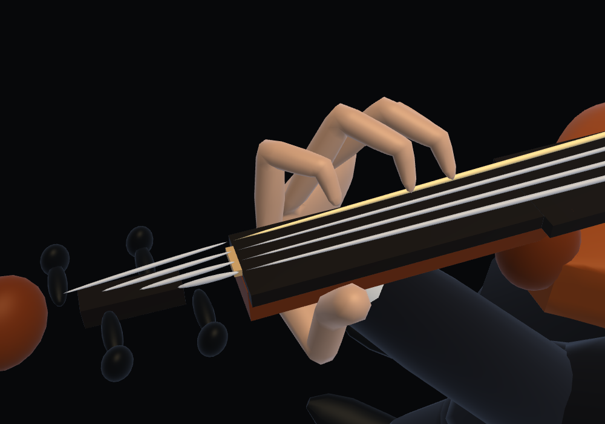
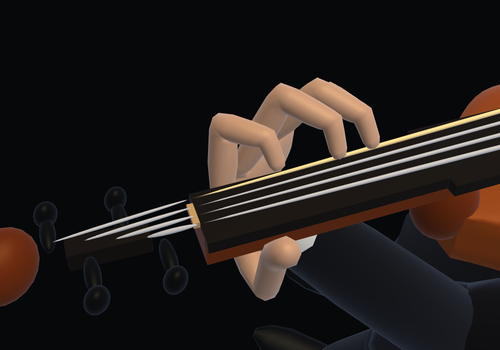
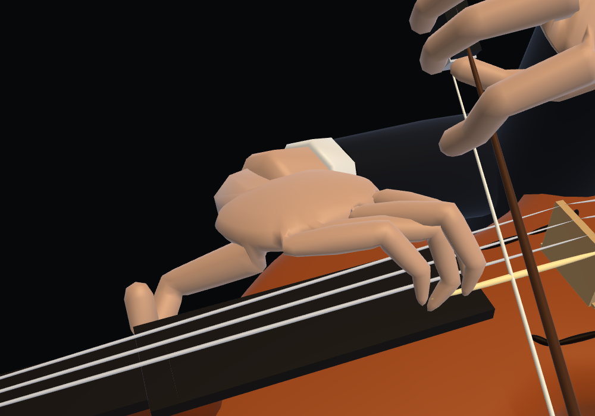
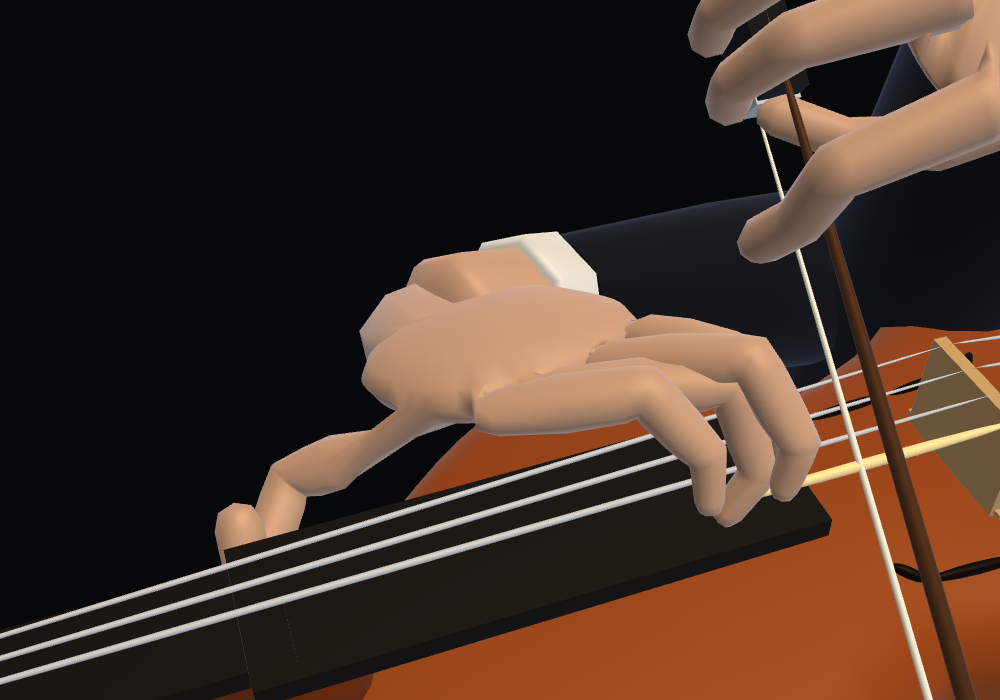
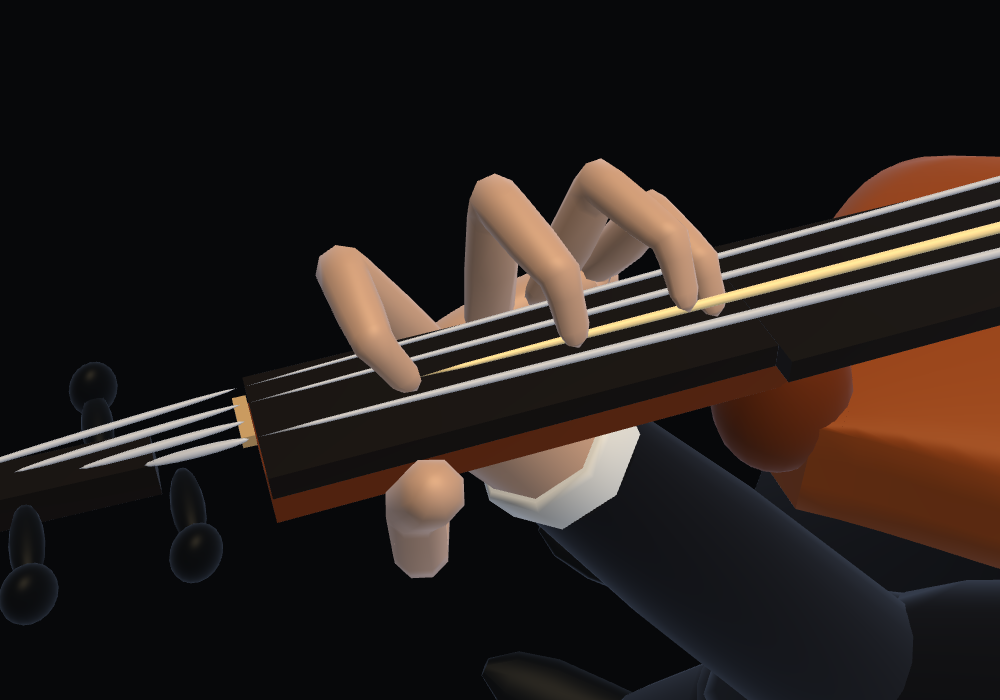
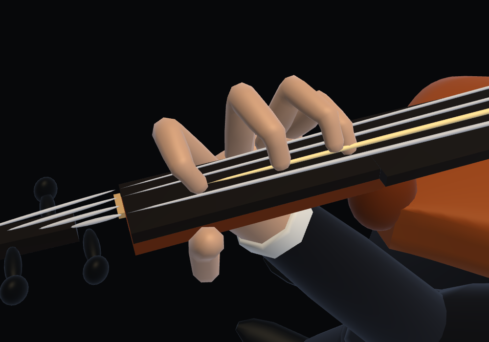
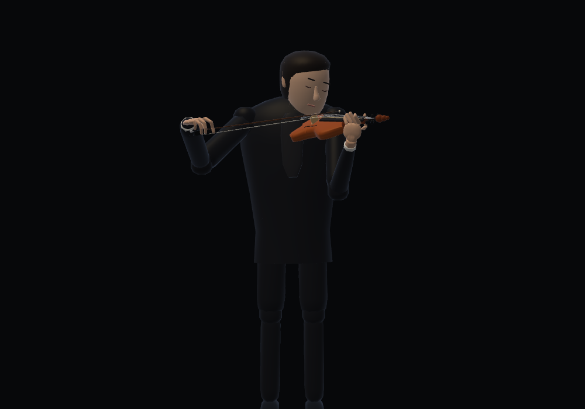

# Violin left-hand proportions and rounded fingertips

The left thumb exposed its entire metacarpal as a separate finger tube, and its distal phalanx was 26 mm long. The four fingers also tapered to a narrow, pointed cap. This change blends the metacarpal into the palm, shortens the thumb's distal phalanx to 18 mm, and makes the four fingers fuller with rounded fingertip pads.

| Shape | Previous | Revised |
| --- | --- | --- |
| Thumb bones, mm | 42 / 32 / 26 | 42 / 32 / 18 |
| Thumb metacarpal skin | Entire bone exposed | Tube starts 65% along the bone, joined to the palm |
| Finger shaft width | Original profile | +18% |
| Finger shaft thickness | Original profile | +20% |
| Fingertip | Narrow ring and conical pole | Ellipsoidal cap, 4.5 mm long |

The musical fingertip stays at the same point. The rounded cap is formed behind that contact using two latitude rings; it does not extend the finger beyond the string. Soft skin at the thicker knuckles can compress against the fingerboard while the skeleton remains fixed.

The thumb's neck seat is determined by its first two bones, which retain their lengths. Only its last bone changes. The existing wrist, elbow and four-finger trajectory data are preserved byte-for-byte in the serialized song entries; [migration verification](migration.json) records their SHA-256 and checks the thumb seat in 5,856 poses. `precompute-violin-hand-style.cjs` refreshes the model stamp for this specific change, without nonlinear refitting.

The profile is selected by `ViolinModel.createLeftSkin()`. Piano, guitar and bow grips retain the default skin geometry. A pinned default-profile geometry fixture and the existing piano, guitar, bow and joined-surface tests check compatibility. The face meshes and bow-holding hand remain unchanged.

Verification:

- [Shape regression](style.json): actual shaft width +18%, wider rounded distal ring, fixed fingertip, closed skin and reused storage.
- [Skeleton and rendered wood clearance](verification.json): 10,261 poses, fixed bone lengths, existing handedness and sounding contacts. Maximum thumb/finger skin overlap with the sampled neck is below 1 mm; board and body overlap is zero.
- [Related instrument / skin regressions](regressions.json).
- [75-second browser playback](browser.json): buffer reuse, zero runtime fitting and instrument switching. Software WebGL; no physical-device listening test is claimed.

The joined hand still uses 1,688 triangles and one dynamic GPU buffer. The cap reuses the existing rings and vertices.

| Pose | Before | After |
| --- | --- | --- |
| Lower position |  |  |
| Higher position |  |  |
| Czardas |  |  |
| Full figure |  |  |

```sh
node precompute-violin-hand-style.cjs
node violin-hand-style-test.cjs
node violin-left-hand-test.cjs
node violin-skin-test.cjs
node hand-surface-test.cjs
```
