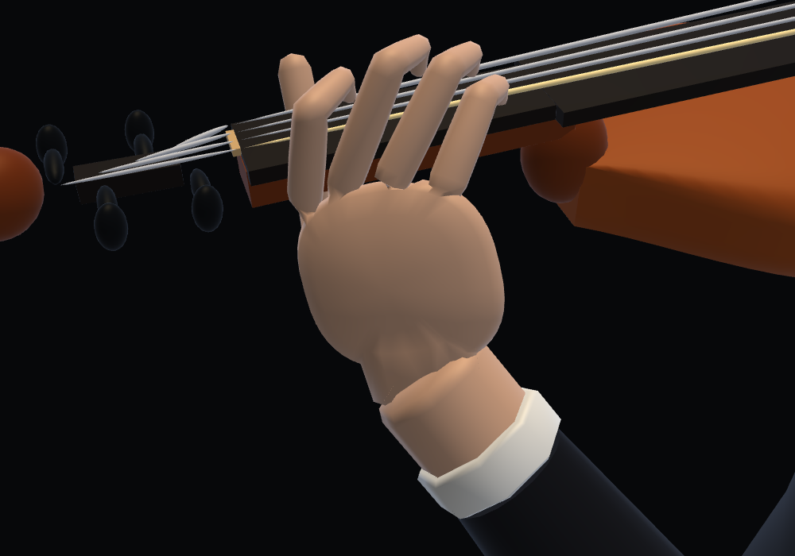
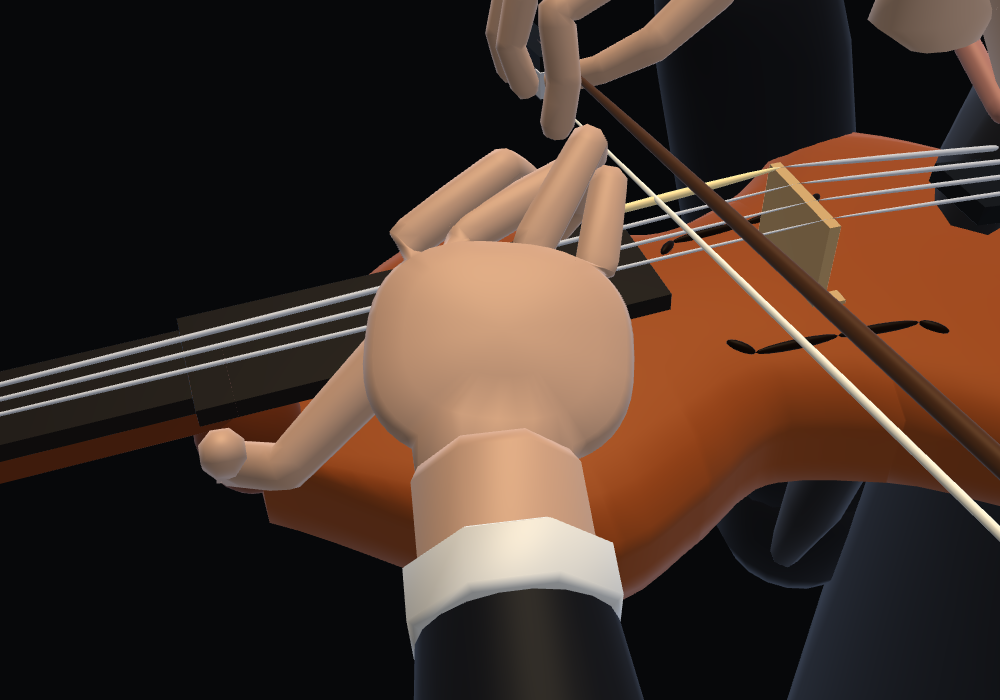
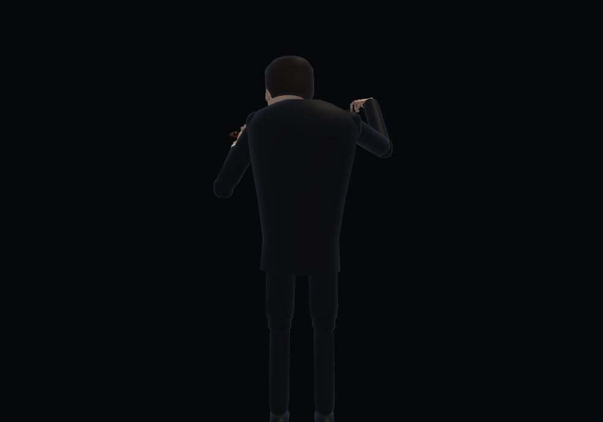

# Violin left hand

The four fingers now share fixed knuckles on a wrist-rooted palm, with fixed phalanx lengths and linked PIP/DIP flexion. Sounding fingertips follow the existing fingering and vibrato targets. The thumb supports the side of the neck in lower positions and moves around the heel in higher positions; its three bones also keep constant lengths. The elbow follows the wrist, with a soft preference for a straight wrist.

Selected proportion **B** shortens the four left fingers by **20%**. Their total bone lengths (index/middle/ring/little) are now 75.2 / 84.8 / 79.2 / 63.2 mm. Palm dimensions, thumb lengths, face geometry and the bow-holding right hand keep their existing sizes. Carriage positions and joint angles are refitted so the shorter fingers still meet the sounding targets.

References reviewed:
- [Manukau Youth Orchestra — Left hand](https://www.manukauyouthorchestra.org.nz/violin/left/): thumb joint beside the neck, open space below it, straight wrist and elbow beneath the instrument.
- [Violin Online — How to hold the violin](https://www.violinonline.com/howtoholdtheviolin.html): relaxed thumb opposite the first/second fingers, wrist clear of the neck.
- [Simon Fischer — The thumb](https://www.simonfischeronline.com/uploads/5/7/7/9/57796211/046thumb.pdf): thumb position varies with the player's anatomy and hand position; keep the thumb/index web open.

`node precompute-violin-hand.cjs` fits the trajectories offline. It saves restartable work in `/tmp/violin-hand-build` (override with `VIOLIN_HAND_WORK`) and generates `dist/instruments/violin-hand-frames.js`. Source and note signatures reject stale data. Playback interpolates coordinates and uses analytic finger IK; it never starts the nonlinear fitting process. Missing or stale data uses the existing motion.

`node violin-left-hand-test.cjs` checks all pieces, note boundaries, fixed roots and bone lengths, sounding contacts, connected wrists, unchanged bow/right arm/head, and zero runtime fitting. Face meshes remain covered by `geometry-test.cjs`.

When changing proportions, `--retarget-from <previous-violin-hand-frames.js>` refits the existing carriage family to the new bone lengths. Save the previous frame file before editing `FINGER_LENGTH_SCALE`; the template's note signature must match. For example:

```sh
VIOLIN_HAND_WORK=/tmp/violin-hand-refit node precompute-violin-hand.cjs --retarget-from /tmp/previous-violin-hand-frames.js --resume-angles
```

`--reuse-carriages` retains the template carriage trajectory while refitting joint angles and clearance. Repairs consider nearby sounding contacts and share carriage corrections across near-coincident keys, keeping the wrist continuous. Sounding targets remain exact; resting fingers use soft targets so they can stay rounded while waiting for an upcoming note.

After regenerating, run `node violin-left-hand-test.cjs` before committing. `--resume-angles` can resume an existing angle checkpoint without repeating the smooth collision-guide refinement; the contact repair and independent rendered-vertex checks still apply.

The thumb follows the interpolated palm carriage, rather than the fingering engine's earlier shift anchor. Free fingers can extend at the MCP joint while preparing a note, and the fingertip pads use a flatter section against the fingerboard.

| Lower position | Higher position |
|---|---|
|  |  |



Verification: 10,261 poses across the three pieces, plus 30 Hz motion and probes around every stored knot. Contact/root/bone errors stay at numerical precision, and playback performs zero nonlinear fits. Rendered vertices are checked at note starts, midpoints, ends and one-second samples against the actual body triangles and board/neck boxes; sampled skin overlap is below 1 mm (body 0 mm, board 0.867 mm, neck 0.978 mm). These clearance results describe the sampled rendered vertices. Bow/right-arm/head states match the existing motion, and the face mesh baseline passes. Full results: [verification.json](verification.json).

The four shortened fingers now use continuous shared-normal surfaces across their joints. The thumb, skeleton and offline trajectories remain unchanged. See [skin implementation and before/after views](../violin-skin/README.md).

All five digits now share one surface with the palm and wrist. [Shared hand skin verification](../hand-joins/README.md) covers the connected topology and updated rendering.
