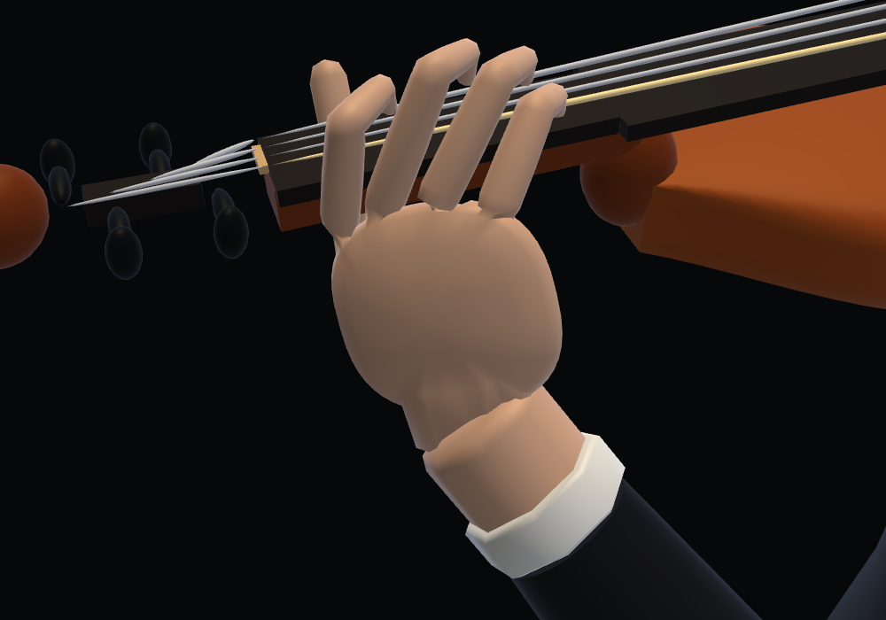
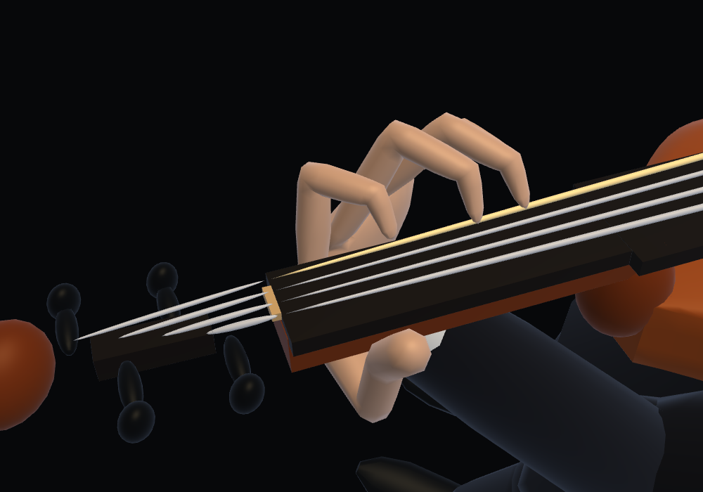
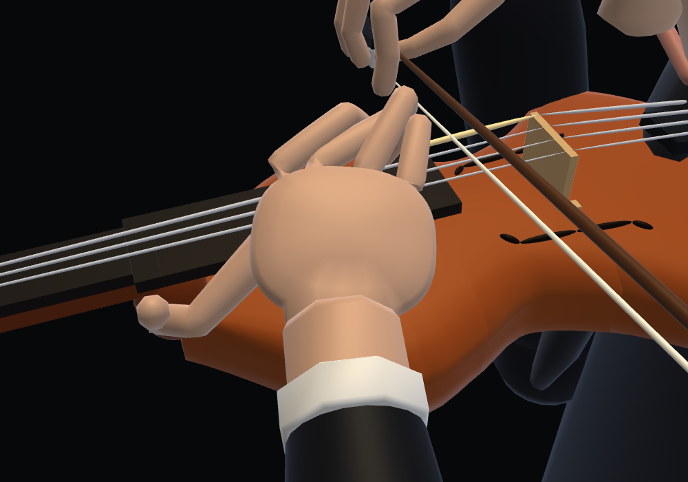
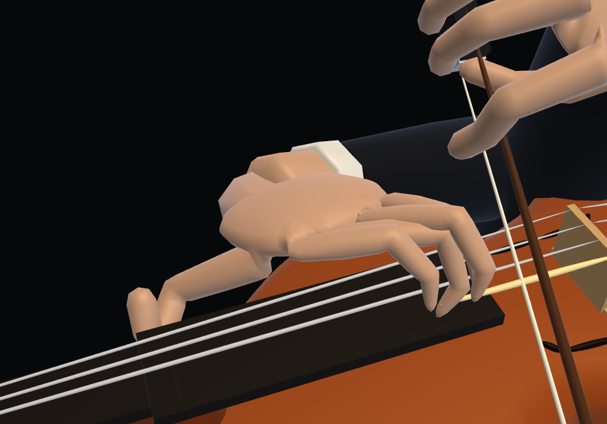

# Anatomical violin left hand

The former palm frame had the right hand's chirality after `RecitalGL` reflected planning X. Reflecting the hand across the longitudinal neck plane corrects the thumb/finger sides without changing the selected B finger lengths or the connected hand surface. The surface receives the mirrored-frame flag so its dorsal axis and winding agree with the skeleton.

String positions now run G–D–A–E from the player's left to right when looking along the neck from bridge to scroll. Bow-plane tilts follow that order. The instrument is rolled 30° with its E edge lower, making space for the forearm below the body. The thumb supports the G side in lower positions and travels around the heel for higher positions. Carriages and elbow swivels are fitted offline; playback continues to interpolate cached joint coordinates.

References checked against the corrected hand:

- [University of Texas String Project — Position and Posture](https://music.utexas.edu/string-project/parent-resources/string-project-position-posture), violin left-hand photographs.
- [Manukau Youth Orchestra — Left hand](https://www.manukauyouthorchestra.org.nz/violin/left/), thumb placement, open thumb/index web and wrist alignment.
- [Andy Tan — Left Hand Posture and Geometry](https://www.andytanviolin.com/resources/left-hand-posture-and-geometry/), palm orientation and balanced support.

| Previous lower position | Corrected lower position |
|---|---|
|  |  |

| Previous higher position | Corrected higher position |
|---|---|
|  |  |

`violin-left-hand-test.cjs` now checks the hand's chirality before and after the renderer's reflection, the physical G/E string order, sounding fingertip contacts, fixed bone lengths, continuous wrists, rendered skin clearance and absence of runtime nonlinear fitting. `hand-surface-test.cjs` checks the mirrored hand's connected surface and normals.

To refit elbow clearance for an already corrected cache:

```sh
node precompute-violin-orientation.cjs
node violin-left-hand-test.cjs
```

For a cache saved **before this orientation correction**, `node precompute-violin-orientation.cjs --from /path/to/old-violin-hand-frames.js` first reflects the old carriage across the neck, then fits the elbow swivels. Do not use `--from` with a corrected cache. A full `precompute-violin-hand.cjs` rebuild can be followed by the same elbow-clearance pass. The offline search uses the actual rendered forearm vertices and body triangles, with a 0.5 mm fitting tolerance; final acceptance remains below the existing 1 mm skin-overlap limit.

The previous integration test required the wrist to stay at least 30 mm to the anatomical left of the torso midline. An E-side grip wraps the wrist around the heel in high positions, allowing a small midline crossover. The test now verifies the left shoulder attachment, rendered left-hand chirality and the sounding fingertips' anatomical left side, while retaining the bow wrist and front-view hand-order checks.

Verification: 10,261 poses in three pieces, fixed finger/arm lengths and sounding fingertip error below 0.000001 mm. Drawn left-hand determinant ≥ 1.000000000000; runtime nonlinear fitting stays at zero. Sampled rendered skin penetration: body 0 mm, board 0.868 mm, neck 0.978 mm, forearm 0.617 mm, all below the existing 1 mm limit. The largest elbow displacement across ±1 μs around a stored knot is 0.064 mm (limit 0.1 mm). See [results](verification.json).

The sampled wrist angle reaches 92.2° in a high-position transition; this change corrects hand chirality and clearance while retaining the previous carriage family. It does not claim that every interpolated pose is an ideal teaching posture.

Geometry/face baseline, connected hand surface, bow-grip, piano-hand and main playback regression checks pass. The [local integration audit](local-integration.json) passes the shell, drawn-handedness and front-view checks. Its sibling-repository byte comparisons could not run because those separate checkouts are unavailable in this environment; the repository test remains intact.

The real-time browser test uses the 231-second Meditation instead of the 77-second Air, so the song cannot finish naturally during a 75-second run plus test overhead. This changes the test fixture only.

[75-second real-time browser run](browser.json): GPU buffers remain constant during playback and song switches, nonlinear fits remain zero, and WebGL/JavaScript errors remain zero. All four instrument switches also pass.
