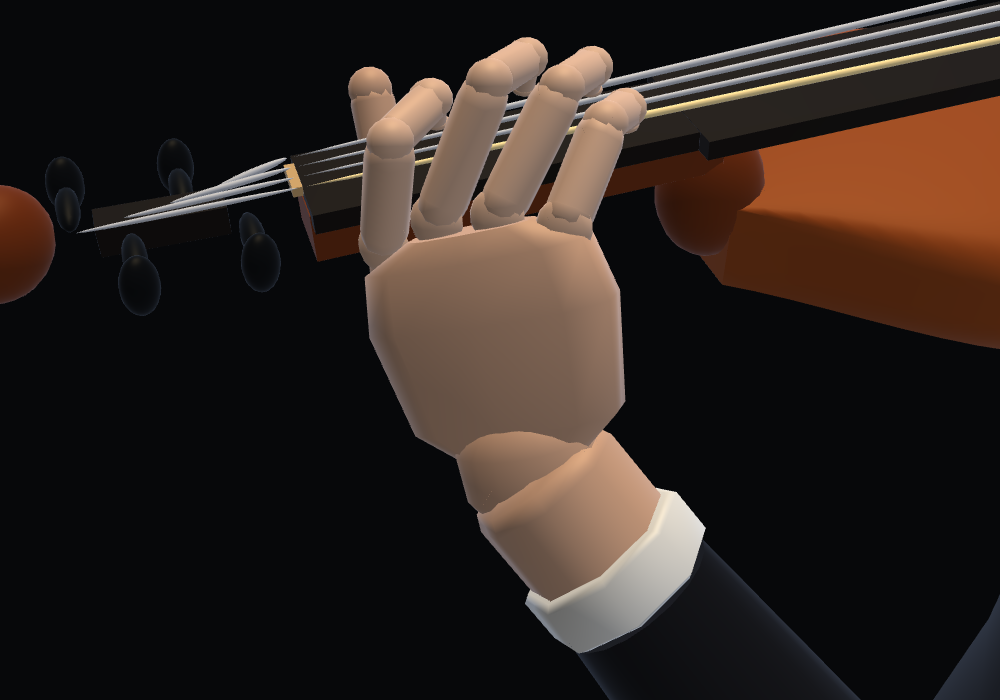
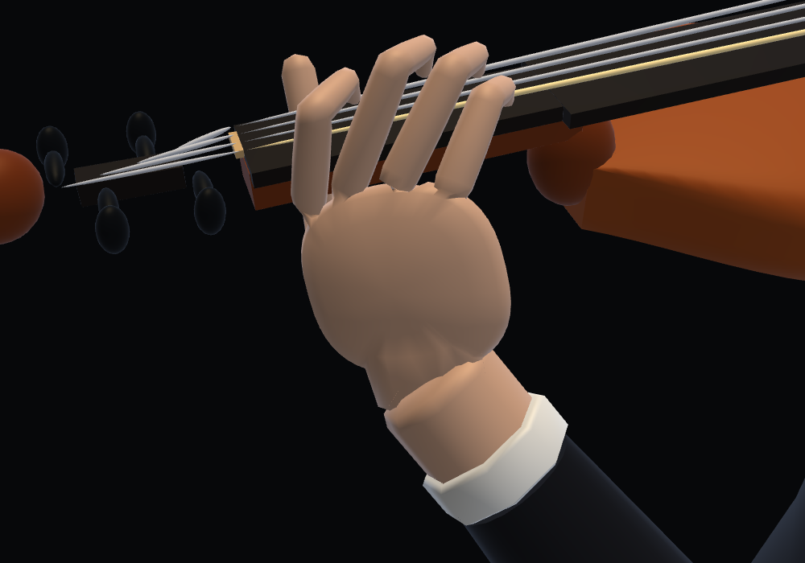
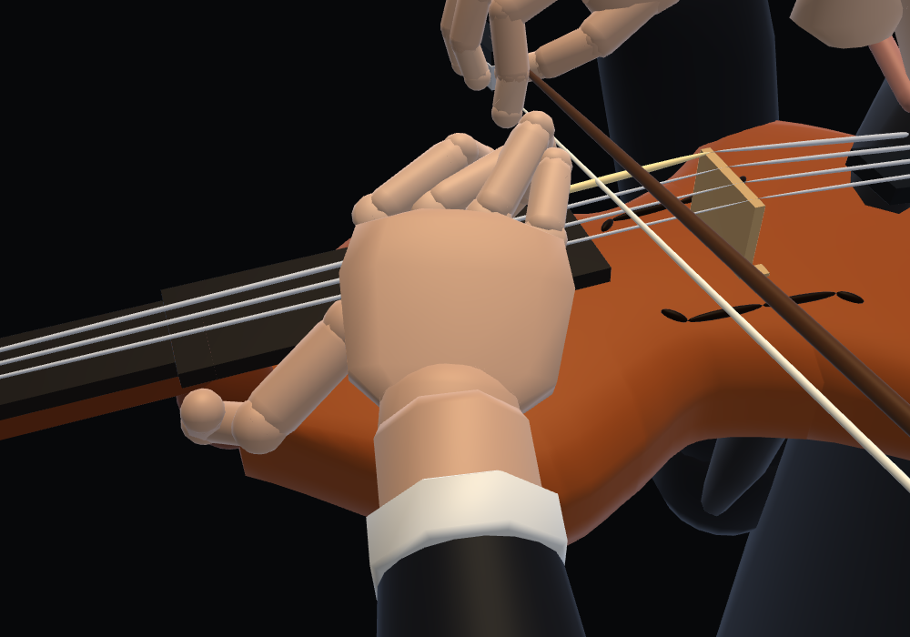

# Continuous violin finger skin

The current hand also joins all digits to the palm and wrist in one surface.
See [shared hand surface verification](../hand-joins/README.md) for current
counts, topology and resource checks. The notes below describe the earlier
finger-only stage; the images show the current hand.

The four left fingers use closed continuous surfaces around the existing FK
skeleton. Each finger has twelve eight-sided rings with shared vertices and
area-weighted normals. Ring tangents blend around the PIP/DIP joints, so bends
have connected skin instead of separate capped rods. The base extends into the
palm; the distal surface flattens against the fingerboard while the exact
sounding target stays fixed. The left thumb and face are unchanged. Bow-hand skin is covered in
[the right-hand verification](../bow-skin/README.md).
The selected B proportions (20% shorter four fingers) remain unchanged.

The four surfaces share one draw call: 768 triangles, replacing 4,224 triangles
and 28 draws. Topology, positions, normals and the 55,296-byte upload array are
allocated once per renderer and reused. The renderer allocates one dynamic GPU
buffer and uses `bufferSubData` afterward. A WeakMap associates CPU storage with
the renderer, allowing storage to be collected with that renderer. Playback does
not allocate new skin meshes, retain pose histories, or run nonlinear fitting.

This is a deliberately small surface mesh. It does not merge the thumb or palm
into a full hand mesh, and it does not use volumetric skin simulation.

| Same low position, before | After |
|---|---|
|  |  |

| Same high position, before | After |
|---|---|
|  |  |

Verification:

- `node violin-skin-test.cjs`: four closed connected components, consistent
  winding, no open edges, unit normals, finite coordinates, unchanged input
  skeleton, and reused typed arrays across 303 poses from all three pieces.
  4,500 drawn frames allocate one GPU buffer once, then make 4,499 updates to
  the same buffer using the same upload array.
- `node violin-left-hand-test.cjs`: sounding contact, fixed bones and roots,
  continuous wrist, unchanged head/right arm/right hand, and sampled rendered
  vertices against body, fingerboard and neck, with the existing 1 mm limit.
  This is a sampled vertex check, not a proof against every triangle collision.
- `NODE_PATH=… node violin-skin-browser-test.cjs`: 75 seconds of actual shell
  playback in Chromium/SwiftShader, stable GPU buffer count, no runtime fitting,
  no WebGL/page errors; switches among all violin pieces and all four instruments.
  This checks playback progression and resource reuse; it is not an auditory
  comparison or an FPS measurement on the reported device.
- `node geometry-test.cjs` preserves the face draw-data fingerprints;
  `node bow-hold-test.cjs` checks the right-hand grips. Local integration checks
  cover module loading, drawing and instrument/song selection. The upstream
  repository byte comparisons require separate checkouts unavailable here.

Machine-readable results are alongside this file. Updated scene counts are in
[geometry-budget](../geometry-budget/README.md).
